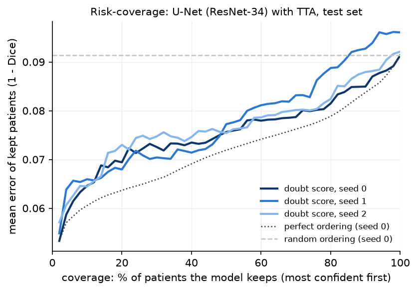

# Cardiac MRI Analyzer

A system that takes a cardiac cine-MRI scan, outlines the heart's chambers with deep learning, turns those
outlines into the numbers cardiologists use (ventricle volumes, ejection fraction, heart-muscle mass, wall
thickness), predicts one of five diagnoses from those numbers with an explainable model, and flags the cases
where the model is unsure. It is built on the public ACDC dataset.

> **Research demo, not a medical device.** Nothing here is validated for clinical use.

## Status

The project is being built in phases (see `docs/`). Phases 0–6 are done: setup, data, three segmenters
evaluated once on the 50 held-out test patients, the clinical numbers derived from their masks, a
diagnosis model with explanations, an uncertainty score, and the backend API. The frontend comes
next. Every number below comes from a file in `results/`.

## Results so far: segmentation on the test set

50 test patients, end-diastole and end-systole, scored per patient in 3D on the original image grid.
U-Nets: mean ± std over 3 training seeds. MedSAM is not trained, so it has one run.

| Model | RV Dice | MYO Dice | LV Dice | RV HD95 | MYO HD95 | LV HD95 |
|---|---|---|---|---|---|---|
| U-Net, from scratch | 0.900 ± 0.005 | 0.877 ± 0.004 | 0.928 ± 0.002 | 4.59 ± 0.47 mm | 3.11 ± 0.24 mm | 3.67 ± 0.34 mm |
| U-Net, ResNet-34 ImageNet encoder | 0.900 ± 0.003 | 0.878 ± 0.002 | 0.932 ± 0.004 | 4.19 ± 0.23 mm | 2.85 ± 0.23 mm | 2.98 ± 0.30 mm |
| MedSAM, zero-shot, **oracle boxes** | 0.877 | 0.471 | 0.896 | 4.31 mm | 8.73 mm | 3.60 mm |


- **Pretraining (RQ2):** no measurable Dice benefit. Paired Wilcoxon tests over the 50 patients give
  p = 0.44 (RV), 0.27 (MYO), 0.24 (LV). HD95 is somewhat lower with the pretrained encoder, but that
  comparison was added after seeing the Dice result and does not survive a correction for multiple tests.
- **MedSAM (RQ3):** even when its box prompts are cut from the expert's own outline, MedSAM is below
  both U-Nets, and it largely fails on the myocardium: a box around the muscle ring makes it outline the
  bright cavity inside. Its numbers are a best case (`docs/decisions.md` D19), not a real-world result.
  Moving the box edges by up to 5 px barely changes them; by up to 20 px, RV and LV Dice drop to 0.681 and
  0.743 (`figures/medsam_jitter.png`).
- These Dice scores are on images the mirror cropped around the expert's LV centre, so they are somewhat
  optimistic compared with full-field scans (`docs/decisions.md` D9).

## Results so far: clinical numbers on the test set

Volumes, ejection fraction (EF), myocardial mass and wall thickness computed from each model's masks,
compared with the same numbers computed from the expert masks (`docs/decisions.md` D21). Each cell is
the **bias** (mean of model − expert) and the **95% limits of agreement** in brackets, over 50 test
patients. U-Nets: averaged over 3 seeds.

| Measurement | expert mean | U-Net, scratch | U-Net, ResNet-34 | MedSAM, oracle boxes |
|---|---|---|---|---|
| LV EDV (mL) | 176.0 | −2.2 [−15.3, +11.0] | −3.6 [−15.1, +8.0] | −15.4 [−48.2, +17.4] |
| LV ESV (mL) | 98.2 | +1.1 [−12.5, +14.6] | −0.8 [−15.4, +13.8] | −9.8 [−35.5, +15.9] |
| LV EF (%) | 51.0 | −1.8 [−9.4, +5.7] | −1.0 [−9.2, +7.3] | +0.3 [−5.4, +6.0] |
| RV EDV (mL) | 171.9 | −3.5 [−29.2, +22.3] | −5.8 [−30.3, +18.8] | −2.5 [−36.4, +31.4] |
| RV ESV (mL) | 93.9 | −3.3 [−34.4, +27.7] | −4.0 [−30.5, +22.6] | +0.4 [−25.1, +25.9] |
| RV EF (%) | 46.8 | +1.3 [−12.3, +14.9] | +1.1 [−13.2, +15.5] | −0.2 [−9.6, +9.1] |
| Myocardial mass (g) | 133.4 | +6.5 [−12.6, +25.5] | +3.6 [−13.4, +20.5] | −84.5 [−137.6, −31.5] |
| Mean wall thickness (mm) | 7.7 | +0.6 [−0.4, +1.5] | +0.5 [−0.4, +1.3] | −4.0 [−5.9, −2.0] |
| Max wall thickness (mm) | 14.8 | +0.5 [−4.3, +5.3] | +0.2 [−5.3, +5.7] | −2.7 [−8.3, +2.9] |


- **RQ4, LV:** both U-Nets measure LV volumes, EF and mass with small bias. For a single patient, LV EF
  can still be off by up to about 9 points (the limits of agreement), so it is close but not
  interchangeable with the expert.
- **RQ4, RV:** RV numbers are clearly less reliable (RV EF limits about ±14 points). The errors
  concentrate in the top slices, where deciding whether the slice still contains ventricle moves the
  volume by a whole 10 mm disc (worked example in `docs/flow.md` §5).
- **MedSAM** underestimates LV volumes and gets the myocardium badly wrong (mass −84.5 g), as its
  Dice suggested. Its EF limits are the narrowest of the three, because its oracle boxes tell it which
  slices contain each structure (for the U-Nets, a main source of error: see the worked example), and
  it under-segments the LV by a similar fraction at ED and ES, so that cancels in the ratio.
- Full statistics per measurement (MAE, Pearson r, per seed) are in `results/clinical.json`; all nine
  Bland-Altman plots per model are in `figures/bland_altman_<model>.png`.

## Results so far: diagnosis on the test set

Five groups (normal, previous infarction, dilated, hypertrophic, abnormal RV), 10 test patients each.
Models are trained on measurements from the **expert** masks of the 100 training patients, then tested
on measurements from the expert masks and from each segmenter's masks (`results/diagnosis.json`).

| Measurements from | ACDC rules (untuned) | Logistic regression | XGBoost |
|---|---|---|---|
| expert masks | 0.70 | 0.88 | 0.86 |
| U-Net, scratch (3 seeds) | 0.67 ± 0.03 | 0.85 ± 0.02 | 0.85 ± 0.01 |
| U-Net, ResNet-34 (3 seeds) | 0.65 ± 0.01 | 0.91 ± 0.02 | 0.88 ± 0.02 |
| MedSAM, oracle boxes | 0.74 | 0.64 | 0.80 |

- **RQ5:** the five groups can be told apart from 18 measurements with 85–91% accuracy (learned models). Most
  errors swap MINF and DCM, which differ in wall motion, something none of the measurements capture.
- Swapping expert masks for U-Net masks barely changes accuracy over 50 patients (1 patient = 2
  points), and 95% of patients get the same diagnosis either way. Individual diagnoses do move:
  `docs/flow.md` §6 follows one patient whose missed RV slice turns a 99% "abnormal RV" into 46%.
- Logistic regression is as good as XGBoost here, except on MedSAM's measurements, whose badly wrong
  myocardial mass a linear model extrapolates and a tree does not (`docs/decisions.md` D24).


## Results so far: does the model know when it is wrong?

Test-time augmentation (10 slightly rotated and mirrored views per slice) gives a doubt map per voxel
and a doubt score per patient (`results/uncertainty.json`, pretrained U-Net, 3 seeds).

- **RQ6:** the doubt score and the actual error (1 − Dice) have a Spearman correlation of
  0.71 ± 0.01. Setting aside the 20% most doubtful patients for a human raises mean Dice on the rest
  from 0.907 to 0.916; a perfect ordering would reach 0.920.
- The plan's views (90° rotations) were tried on validation first and dropped: the model had never
  seen a heart turned that far and its "doubt" measured the rotation, not the patient (D26).



## Quick start

You need [uv](https://docs.astral.sh/uv/) installed. Everything runs inside a project-local virtual
environment in `.venv/`; nothing is installed into your system or Anaconda Python. On macOS, XGBoost also
needs the OpenMP runtime, which is a system library (`brew install libomp`).

```bash
make setup    # installs Python 3.11 if needed, creates .venv/ and installs every pinned dependency
make data     # downloads ACDC (~1.1 GB), verifies it, prints a summary, writes the patient splits
make test     # runs the test suite inside .venv/
make lint     # ruff (lint + format check) and mypy
```

Reproducing the results and running the backend:

```bash
make train    # both U-Nets, 3 seeds each (about 2.5 hours on an Apple M4)
make eval     # test-set evaluation, clinical numbers, uncertainty, diagnosis → results/, figures/
make samples  # normal ranges and the 5 precomputed sample patients for the app
make api      # backend on http://localhost:8000 (interactive API docs at /docs)
```

The trained weights are not in git (`docs/decisions.md` D5), so `make api` needs `make train` and
`make eval` first. Without weights the backend still starts and serves the samples and metrics;
uploads answer with an explanation instead.

To use the environment directly, either prefix commands with `uv run` (for example `uv run python`) or
activate it with `source .venv/bin/activate`.

## Project structure

```
configs/     training and classifier configs (YAML)
data/        downloaded data (git-ignored) and splits.json (patient ids only, committed)
notebooks/   data exploration; saves its figures to figures/
scripts/     data download, splits, demo export
src/cardiac/ the research package: data, models, training, metrics, clinical maths, diagnosis
backend/     FastAPI app (inference only, never trains)
frontend/    React + TypeScript app
tests/       pytest suite
results/     metrics from real runs (small JSON files, committed)
figures/     figures used by this README and the docs
docs/        architecture, execution flow, design decisions, ML basics for beginners
```

## Data and licences

Code is MIT-licensed (see `LICENSE`). The ACDC data is **not** in this repository and is under its own
licence, CC BY-NC-SA 4.0 (non-commercial).

**Which copy of ACDC.** I use the preprocessed Hugging Face mirror
[`mathpluscode/ACDC`](https://huggingface.co/datasets/mathpluscode/ACDC), pinned to commit `4a312b6`,
instead of the official download (which needs a registration). The mirror is not the raw data, and that
affects the results:

- Every scan was **resampled to 1 × 1 × 10 mm** voxels. All volumes, masses and distances in this project
  are computed with that resampled spacing (read from each file's header), not the original scanner
  spacing. 23 of 150 patients originally had 5–6.5 mm slice gaps and were resampled through-plane.
- Every image was **cropped to 192 × 192 around the expert's LV centre**, so the models never have to
  locate the heart. Segmentation scores are somewhat optimistic compared with full-field scans.
- The cine has no real frame timing, so playback in the app uses a fixed speed.

The reasoning and the alternatives are in `docs/decisions.md` (D9).

If you use ACDC, cite:
O. Bernard et al., "Deep Learning Techniques for Automatic MRI Cardiac Multi-Structures Segmentation and
Diagnosis: Is the Problem Solved?", *IEEE Transactions on Medical Imaging*, 37(11), 2018.
