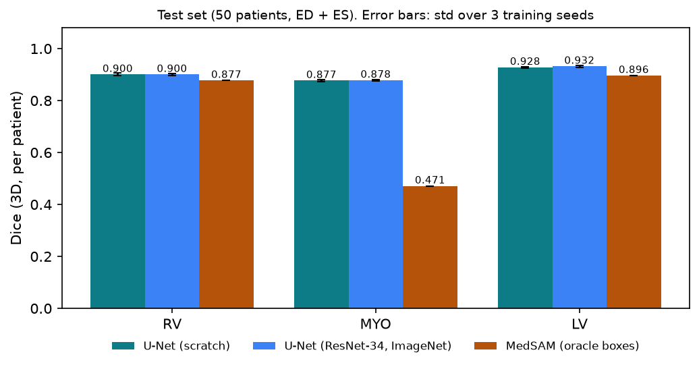

# Cardiac MRI Analyzer

A system that takes a cardiac cine-MRI scan, outlines the heart's chambers with deep learning, turns those
outlines into the numbers cardiologists use (ventricle volumes, ejection fraction, heart-muscle mass, wall
thickness), predicts one of five diagnoses from those numbers with an explainable model, and flags the cases
where the model is unsure. It is built on the public ACDC dataset.

> **Research demo, not a medical device.** Nothing here is validated for clinical use.

## Status

The project is being built in phases (see `docs/`). Phases 0–3 are done: setup, data, and three
segmenters evaluated once on the 50 held-out test patients. Clinical measurements, diagnosis, uncertainty
and the app come next. Every number below comes from `results/segmentation.json`.

## Results so far: segmentation on the test set

50 test patients, end-diastole and end-systole, scored per patient in 3D on the original image grid.
U-Nets: mean ± std over 3 training seeds. MedSAM is not trained, so it has one run.

| Model | RV Dice | MYO Dice | LV Dice | RV HD95 | MYO HD95 | LV HD95 |
|---|---|---|---|---|---|---|
| U-Net, from scratch | 0.900 ± 0.005 | 0.877 ± 0.004 | 0.928 ± 0.002 | 4.59 ± 0.47 mm | 3.11 ± 0.24 mm | 3.67 ± 0.34 mm |
| U-Net, ResNet-34 ImageNet encoder | 0.900 ± 0.003 | 0.878 ± 0.002 | 0.932 ± 0.004 | 4.19 ± 0.23 mm | 2.85 ± 0.23 mm | 2.98 ± 0.30 mm |
| MedSAM, zero-shot, **oracle boxes** | 0.877 | 0.471 | 0.896 | 4.31 mm | 8.73 mm | 3.60 mm |



- **Pretraining (RQ2):** no measurable Dice benefit. Paired Wilcoxon tests over the 50 patients give
  p = 0.44 (RV), 0.27 (MYO), 0.24 (LV). HD95 is somewhat lower with the pretrained encoder, but that
  comparison was added after seeing the Dice result and does not survive a correction for multiple tests.
- **MedSAM (RQ3):** even when its box prompts are cut from the expert's own outline, MedSAM is below
  both U-Nets, and it largely fails on the myocardium: a box around the muscle ring makes it outline the
  bright cavity inside. Its numbers are a best case (`docs/decisions.md` D19), not a real-world result.
  Moving the box edges by up to 5 px barely changes them; by up to 20 px, RV and LV Dice drop to 0.681 and
  0.743 (`figures/medsam_jitter.png`).
- These Dice scores are on images the mirror cropped around the expert's LV centre, so they are somewhat
  optimistic compared with full-field scans (`docs/decisions.md` D9).

## Quick start

You need [uv](https://docs.astral.sh/uv/) installed. Everything runs inside a project-local virtual
environment in `.venv/`; nothing is installed into your system or Anaconda Python. On macOS, XGBoost also
needs the OpenMP runtime, which is a system library (`brew install libomp`).

```bash
make setup    # installs Python 3.11 if needed, creates .venv/ and installs every pinned dependency
make data     # downloads ACDC (~1.1 GB), verifies it, prints a summary, writes the patient splits
make test     # runs the test suite inside .venv/
make lint     # ruff (lint + format check) and mypy
```

To use the environment directly, either prefix commands with `uv run` (for example `uv run python`) or
activate it with `source .venv/bin/activate`.

## Project structure

```
configs/     training and classifier configs (YAML)
data/        downloaded data (git-ignored) and splits.json (patient ids only, committed)
notebooks/   data exploration; saves its figures to figures/
scripts/     data download, splits, demo export
src/cardiac/ the research package: data, models, training, metrics, clinical maths, diagnosis
backend/     FastAPI app (inference only, never trains)
frontend/    React + TypeScript app
tests/       pytest suite
results/     metrics from real runs (small JSON files, committed)
figures/     figures used by this README and the docs
docs/        architecture, execution flow, design decisions, ML basics for beginners
```

## Data and licences

Code is MIT-licensed (see `LICENSE`). The ACDC data is **not** in this repository and is under its own
licence, CC BY-NC-SA 4.0 (non-commercial).

**Which copy of ACDC.** I use the preprocessed Hugging Face mirror
[`mathpluscode/ACDC`](https://huggingface.co/datasets/mathpluscode/ACDC), pinned to commit `4a312b6`,
instead of the official download (which needs a registration). The mirror is not the raw data, and that
affects the results:

- Every scan was **resampled to 1 × 1 × 10 mm** voxels. All volumes, masses and distances in this project
  are computed with that resampled spacing (read from each file's header), not the original scanner
  spacing. 23 of 150 patients originally had 5–6.5 mm slice gaps and were resampled through-plane.
- Every image was **cropped to 192 × 192 around the expert's LV centre**, so the models never have to
  locate the heart. Segmentation scores are somewhat optimistic compared with full-field scans.
- The cine has no real frame timing, so playback in the app uses a fixed speed.

The reasoning and the alternatives are in `docs/decisions.md` (D9).

If you use ACDC, cite:
O. Bernard et al., "Deep Learning Techniques for Automatic MRI Cardiac Multi-Structures Segmentation and
Diagnosis: Is the Problem Solved?", *IEEE Transactions on Medical Imaging*, 37(11), 2018.
