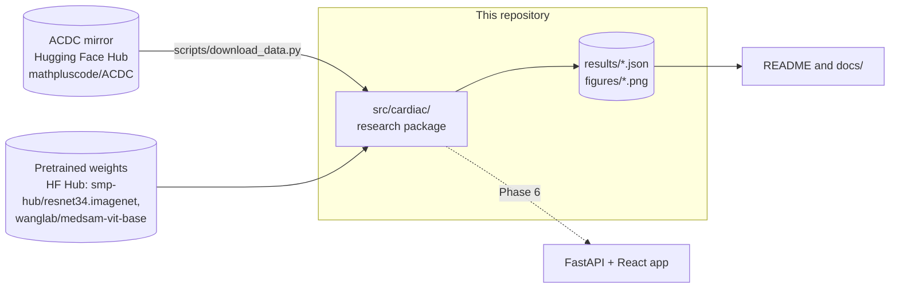
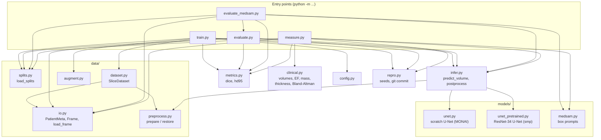
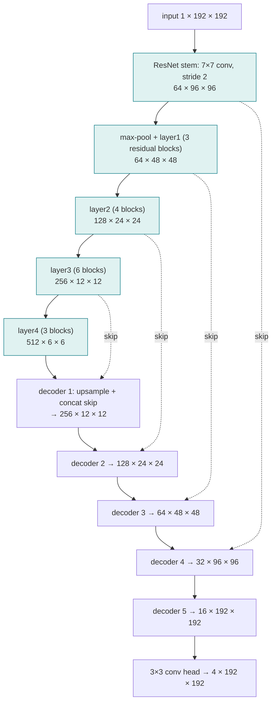
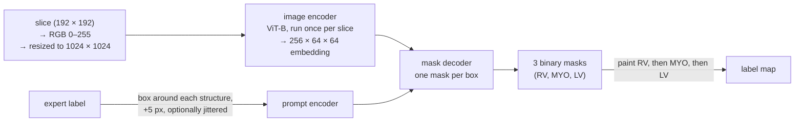

# Architecture

What the pieces are and how they connect. `flow.md` follows execution step by step; this file is the
map. Sections are added in the phase that builds each part: the research package and the three
segmenters (Phases 3–4), the backend in Phase 6, the frontend in Phase 7, deployment in Phase 8.

---

## 1. System context

Everything downloaded is pinned to an exact revision (dataset commit `4a312b6`, MedSAM commit
`de8488b`), so the inputs are the same on every machine.

## 2. The research package, `src/cardiac/`

Which module calls which. Arrows point from the caller to what it uses.

`clinical.py` is pure arithmetic on label maps: it never sees an image or a model, so the same code
measures expert masks, U-Net masks, MedSAM masks and, later, masks from an upload in the app.

`infer.py` is the one place that turns an image into a label map. Training (for validation), evaluation
and, later, the web backend all call it, so they cannot drift apart.

## 3. The three segmenters

All three take a 192 × 192 greyscale slice and return a label per pixel (0 background, 1 RV, 2 MYO,
3 LV). They differ in what they know before they see our data.

| | Scratch U-Net | Pretrained U-Net | MedSAM |
|---|---|---|---|
| Library | MONAI `UNet` | `segmentation_models_pytorch` `Unet` | `transformers` `SamModel` |
| Parameters | 6.5 M | 24.4 M (21.3 M encoder + 3.2 M decoder) | 93.7 M |
| Starts from | random weights | ResNet-34 trained on ImageNet photos (encoder only) | MedSAM, trained on ~1.5 M medical image–mask pairs |
| Trained on our 80 patients | yes, all weights | yes, all weights (lr 3e-4) | no, never |
| Input at inference | slice | slice | slice **plus a box around each structure** |
| Normalisation layers | instance norm | batch norm | layer norm (ViT) |

### 3a. Scratch U-Net

Drawn with measured shapes in `ml_basics.md` §7: five levels, 32 → 512 channels, 192 → 12 pixels at
the bottom.

### 3b. Pretrained U-Net (ResNet-34 encoder)

Shapes measured from the real model for one 192 × 192 slice (channels × height × width):

The shaded encoder blocks start with ImageNet weights; the decoder and head start random. Compared
with the scratch U-Net, it goes one level deeper (6 × 6 at the bottom) and has 3.8× as many weights,
almost all in the encoder.

The first convolution was built for 3 colour channels. `smp` turns it into a 1-channel convolution by
**summing** the red, green and blue weights, so a grey MRI slice excites it the way a grey photo with
the same brightness would.

### 3c. MedSAM (zero-shot, oracle boxes)

Two things set it apart. First, it needs a prompt: here, boxes cut from the **expert's** answer, which
also tell it which slices contain each structure. Second, the expensive image encoder runs once per
slice and the cheap decoder once per box, so trying four jitter levels costs little more than one.
`decisions.md` D19 explains why these oracle boxes make this a best case for MedSAM, not a fair
real-world comparison.
