# Execution flow

This file follows real execution through the code, step by step, with file and function names. Read it
next to the code. Each section is written in the phase that builds that part of the pipeline.

1. [`make data`: download, verify, split](#1-make-data-download-verify-split) (Phase 1)
2. One training step, from NIfTI file to gradient update (Phase 2)
3. A full training run with early stopping (Phase 2)
4. Inference on one patient (Phase 2)
5. [Clinical calculation, worked example](#5-clinical-calculation-worked-example) (Phase 4)
6. [Diagnosis and SHAP for the same patient](#6-diagnosis-and-shap-for-the-same-patient) (Phase 5)
7. [An upload in the app](#7-an-upload-in-the-app) (Phase 6)
8. [Report generation](#8-report-generation) (Phase 6)
9. The evaluation run that writes `results/` (Phases 3–5)
10. [What happens when something goes wrong](#10-what-happens-when-something-goes-wrong) (Phase 6)

---

## 1. `make data`: download, verify, split

`make data` runs two scripts, one after the other, both inside `.venv/` through `uv run`:

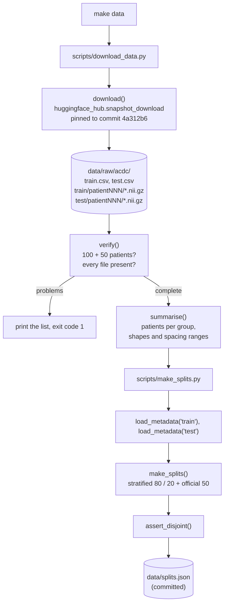

### 1a. Download

`download()` in `scripts/download_data.py` calls `snapshot_download` with a list of file patterns. It is
pinned to one commit of the dataset (`REVISION`), so running it next year fetches byte-identical files.
Files already on disk from an earlier run are not fetched again. With `--no-cine`
(`make data-lite`) it skips the 4D cine files, which are about 1 GB of the 1.1 GB total; training doesn't
need them, only the app's playback does.

What lands on disk, per patient:

```
data/raw/acdc/train/patient001/
├── patient001_sax_ed.nii.gz      3D image at end-diastole   (192, 192, 10)  float, 0–255
├── patient001_sax_ed_gt.nii.gz   expert labels at ED        (192, 192, 10)  0 bg, 1 RV, 2 MYO, 3 LV
├── patient001_sax_es.nii.gz      3D image at end-systole
├── patient001_sax_es_gt.nii.gz   expert labels at ES
└── patient001_sax_t.nii.gz       4D cine, the whole beat     (192, 192, 10, 30)
```

`sax` means short-axis: each slice cuts across the heart, like slicing a loaf of bread.

### 1b. Reading a patient (`src/cardiac/data/io.py`)

Everything else in the project reads data through three functions:

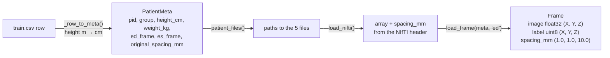

`load_frame` does more than read. It refuses to return a frame if the image and label shapes differ, if
their spacings differ, if the header has no valid spacing, or if the label contains any value other than
0–3. A broken file fails here, loudly, instead of quietly producing a wrong volume three steps later.

The spacing always comes from the file header (`load_nifti`), never from a constant in the code. This is
why the same code would work on the official ACDC data, where every patient has a different spacing.

### 1c. Verify and summarise

`verify()` loads both CSVs and checks that every expected file exists. `summarise()` then opens every ED
image to print the real shapes and spacings. This is the output on the pinned mirror:

```
All expected files are present.

train: 100 patients
  per group: NOR 20, MINF 20, DCM 20, HCM 20, RV 20
  mirror shape (X, Y, Z)   192-192  192-192  5-11
  mirror spacing mm        1-1  1-1  10-10
  original spacing mm      0.703125-1.91964  0.703125-1.91964  5-10
  patients whose original slices were thinner than 10 mm: 14

test: 50 patients
  per group: NOR 10, MINF 10, DCM 10, HCM 10, RV 10
  mirror shape (X, Y, Z)   192-192  192-192  6-11
  mirror spacing mm        1-1  1-1  10-10
  original spacing mm      1.36719-1.95312  1.36719-1.95312  5-10
  patients whose original slices were thinner than 10 mm: 9
```

Two things to notice. Every scan in the mirror has the same spacing, but the originals did not (that's
the resampling described in `decisions.md` D9). And the number of slices varies from 5 to 11, because
hearts are different heights; the model works on one slice at a time, so this doesn't matter for
training, but every volume is a sum over however many slices a patient has.

### 1d. Splits (`scripts/make_splits.py`, `src/cardiac/data/splits.py`)

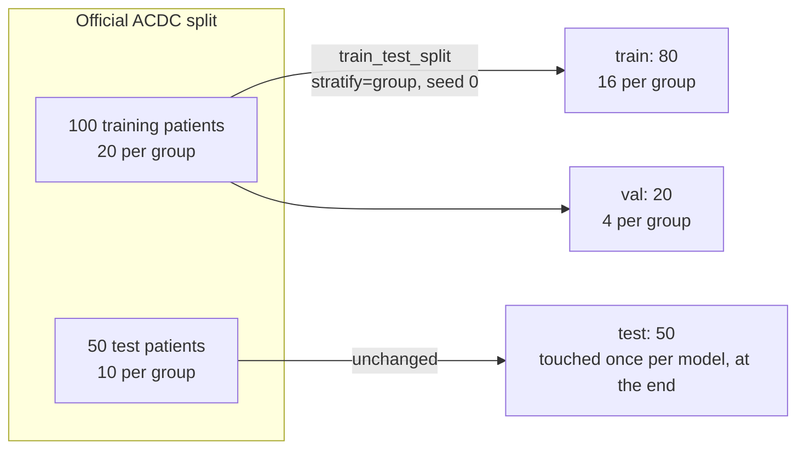

`make_splits()` uses scikit-learn's `train_test_split` with `stratify=groups`, which guarantees each group
contributes exactly 4 validation patients. The official test patients pass straight through.
`assert_disjoint()` then checks that no id appears in two splits (and none appears twice in one split)
before anything is written. Output:

```
Wrote data/splits.json
  train  80 patients  (NOR 16, MINF 16, DCM 16, HCM 16, RV 16)
  val    20 patients  (NOR 4, MINF 4, DCM 4, HCM 4, RV 4)
  test   50 patients  (NOR 10, MINF 10, DCM 10, HCM 10, RV 10)
```

`data/splits.json` holds only patient ids plus a `provenance` block (seed and rule). It is the one file
in `data/` that is committed, so every later phase, on any machine, uses the same patients for the same
purpose. `load_splits()` re-checks disjointness every time the file is read.

### 1e. Tests that guard this step

| Test | What it protects against |
|---|---|
| `tests/test_splits.py::test_no_patient_in_two_splits` | Data leakage between train, val and test |
| `tests/test_splits.py::test_sizes_and_stratification` | A validation set missing a disease |
| `tests/test_splits.py::test_committed_splits_file_is_disjoint_and_complete` | Someone hand-editing `splits.json` |
| `tests/test_io.py::test_spacing_comes_from_header` | Volumes computed from a hard-coded spacing |
| `tests/test_io.py::test_unknown_label_value_is_rejected` | A corrupted label file slipping through |

The I/O tests build tiny synthetic NIfTI files in a temporary folder, so they run in a second without the
real dataset.

### 1f. Looking at the data

`notebooks/01_data_exploration.ipynb` (`make explore`) reads only the 100 training patients and saves
five figures to `figures/`. The one that matters most for later phases:


These are computed from the expert masks, not from any model. Dilated hearts (DCM) are big and pump
weakly; hypertrophic hearts (HCM) pump strongly; previous infarction (MINF) sits in between. If the
segmentation is good, the diagnosis classifier in Phase 5 has a clear signal to work with.

---

## 2. One training step, from a NIfTI file to a gradient update

Command: `make train`, which runs `uv run python -m cardiac.train --config configs/unet_scratch.yaml`.

Before the first step, everything is loaded once and kept in memory:

```mermaid
sequenceDiagram
    participant T as train.py
    participant C as config.py
    participant S as splits.py
    participant IO as io.py
    participant P as preprocess.py
    participant DS as dataset.py
    T->>C: load_config("configs/unet_scratch.yaml")
    C-->>T: Config (typed; unknown keys are an error)
    T->>T: set_seed(0), make_run_dir() → runs/unet_scratch/<time>-seed0/
    T->>S: load_splits("data/splits.json")
    S-->>T: 80 train ids, 20 val ids (re-checked for overlap)
    loop each patient × {ED, ES}
        T->>IO: load_frame(root, meta, phase)
        IO-->>T: image (192,192,Z) float32, label uint8, spacing (1,1,10)
        T->>P: prepare(image, spacing, label)
        P-->>T: slices (Z,192,192) z-scored, labels (Z,192,192)
    end
    T->>DS: SliceDataset(train volumes, training_transforms())
    DS-->>T: 1,372 slices, as arrays (1372, 1, 192, 192)
```

Then one training step, on one batch:

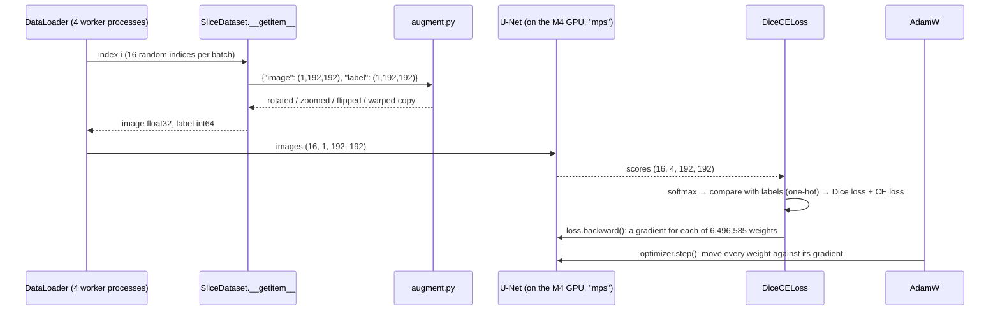

Shapes at each stage:

| Stage | Shape | dtype | Where |
|---|---|---|---|
| NIfTI image on disk | (192, 192, Z), Z = 5–11 | float | `load_nifti` |
| after `prepare` | (Z, 192, 192) | float32, mean 0, std 1 | `preprocess.py` |
| one dataset item | (1, 192, 192) | float32 / int64 | `SliceDataset.__getitem__` |
| one batch | (16, 1, 192, 192) | float32 | `DataLoader` |
| model output | (16, 4, 192, 192) | float32 scores | `UNet.forward` |
| loss | () a single number | float32 | `DiceCELoss` |

## 3. A full training run with early stopping

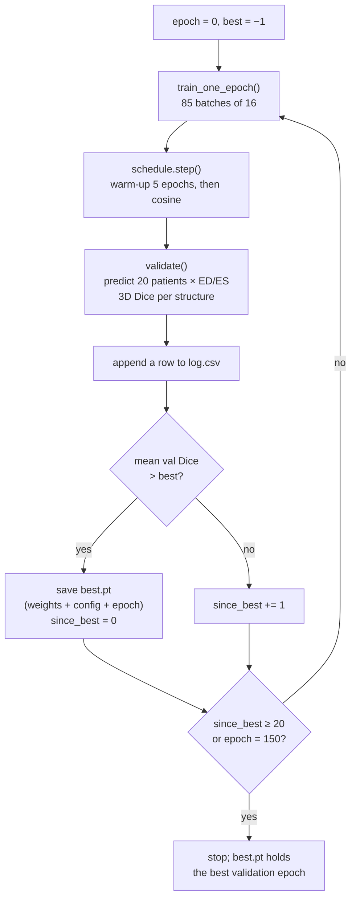

Validation is done the same way the final numbers are reported: whole 3D volumes, one Dice per
structure per patient per phase, then averaged. Checkpoints are chosen on these 3D scores, not on
per-slice scores. Validation during training skips post-processing to keep it fast; the evaluation
step below measures both.

Each run folder holds:

```
runs/unet_scratch/20261122-185431-seed0/
├── config.yaml       the exact settings used
├── git_commit.txt    the code version (and a note if there were uncommitted changes)
├── log.csv           one row per epoch: lr, train loss, val Dice per structure, seconds
└── best.pt           weights from the best validation epoch (never committed to git)
```

## 4. Inference on one patient

`predict_volume()` in `src/cardiac/infer.py`, as used by `cardiac.evaluate` and later by the app:

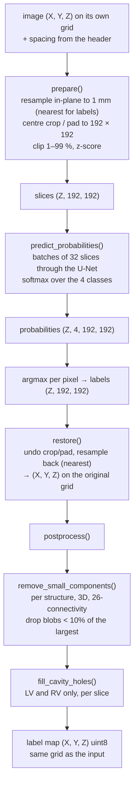

Two details matter:

- **Predictions go back to the original grid before anything is measured.** Dice, HD95 and every
  volume are computed on the scan's own voxels with its own spacing. On the mirror this is the identity
  (it is already 1 mm, 192 × 192), but `tests/test_preprocess.py` checks the round trip for crop, pad
  and resample cases, because uploads in the app won't be.
- **Post-processing never fills the myocardium.** The myocardium is a ring around the LV; filling its
  "hole" would swallow the LV. Only the two cavities are filled, and only where the hole is background.

Evaluation (`uv run python -m cardiac.evaluate --run <run folder> --split val`) runs this for every
validation patient and phase, both with and without `postprocess()`, and writes per-patient rows to
`results/val/<name>_seed<k>.csv` plus mean ± std per structure, phase and group to the matching
`.json`. The headline numbers are post-processed; the raw ones are kept to measure what
post-processing actually changes.

---

## 5. Clinical calculation, worked example

`cardiac.measure` (in `src/cardiac/measure.py`) turns label maps into one row of numbers per patient,
using the formulas in `src/cardiac/clinical.py` (`ml_basics.md` §14).

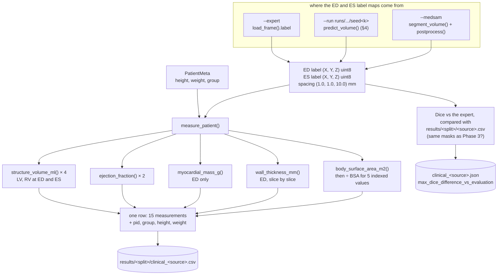

### Test patient129, by hand

I picked this patient by a rule, not by looking: it has the **median** LV ejection fraction error of
the pretrained U-Net (seed 0) across the 50 test patients, so it is a typical case. It belongs to the
"abnormal RV" group. Height 183 cm, weight 75 kg; 8 slices of 192 × 192 pixels, spacing
1 × 1 × 10 mm, so **one voxel = 0.01 mL**. (Its original slices were 5 mm apart; the mirror resampled
them to 10 mm, `decisions.md` D9.)

**Step 1: count voxels per slice.** Slice 0 is the base of the heart (near the valves), slice 7 the
apex. Expert and pretrained U-Net (seed 0), end-diastole:

| slice | 0 | 1 | 2 | 3 | 4 | 5 | 6 | 7 | total |
|---|---|---|---|---|---|---|---|---|---|
| LV, expert | 3,031 | 3,029 | 2,854 | 2,632 | 2,459 | 2,015 | 1,085 | 515 | 17,620 |
| LV, U-Net | 2,795 | 3,019 | 2,830 | 2,673 | 2,352 | 1,893 | 1,118 | 509 | 17,189 |
| RV, expert | 3,061 | 4,393 | 4,403 | 3,674 | 3,356 | 2,774 | 1,908 | 1,388 | 24,957 |
| RV, U-Net | **255** | 4,190 | 4,127 | 3,317 | 3,190 | 2,404 | 1,830 | 1,223 | 20,536 |

And end-systole:

| slice | 0 | 1 | 2 | 3 | 4 | 5 | 6 | 7 | total |
|---|---|---|---|---|---|---|---|---|---|
| LV, expert | 1,452 | 1,352 | 1,396 | 1,398 | 1,244 | 1,043 | 257 | 123 | 8,265 |
| LV, U-Net | 1,437 | 1,370 | 1,400 | 1,380 | 1,081 | 580 | 379 | 117 | 7,744 |
| RV, expert | 0 | 3,922 | 3,343 | 2,721 | 2,410 | 1,780 | 984 | 642 | 15,802 |
| RV, U-Net | 0 | **0** | 3,169 | 2,722 | 2,407 | 1,595 | 1,079 | 559 | 11,531 |

**Step 2: volumes and ejection fraction.**

```
                    expert                               U-Net (ResNet-34, seed 0)
LV EDV   17,620 × 0.01 = 176.20 mL                 17,189 × 0.01 = 171.89 mL
LV ESV    8,265 × 0.01 =  82.65 mL                  7,744 × 0.01 =  77.44 mL
LV EF    (176.20 − 82.65) / 176.20 = 53.1 %        (171.89 − 77.44) / 171.89 = 54.9 %

RV EDV   24,957 × 0.01 = 249.57 mL                 20,536 × 0.01 = 205.36 mL
RV ESV   15,802 × 0.01 = 158.02 mL                 11,531 × 0.01 = 115.31 mL
RV EF    (249.57 − 158.02) / 249.57 = 36.7 %       (205.36 − 115.31) / 205.36 = 43.8 %
```

**Step 3: mass, thickness, body size.**

```
MYO at ED   expert 8,864 voxels × 0.01 × 1.05 =  93.1 g      U-Net 11,032 voxels → 115.8 g
wall        expert mean 5.7 mm, max 10.6 mm                  U-Net mean 7.3 mm, max 11.2 mm
BSA         √(183 × 75 / 3600) = 1.95 m²
LV EDV i    176.20 / 1.95 = 90.2 mL/m²                       171.89 / 1.95 = 88.0 mL/m²
mass i       93.1 / 1.95 = 47.7 g/m²                         115.8 / 1.95 = 59.3 g/m²
```

**What the example shows.**

- **LV numbers are close** (EF 54.9% vs 53.1%). Small differences spread over many slices partly
  cancel.
- **The RV error lives in the top slices.** At end-diastole the U-Net finds almost no RV on slice 0
  (255 voxels vs 3,061), and at end-systole none on slice 1 (0 vs 3,922). Each of those misses is a
  whole 10 mm disc: about 28 mL and 39 mL. Deciding whether the top slice still contains ventricle is
  the hardest call in short-axis MRI, for people too, and with 10 mm slices it moves the volume a lot.
  Because the ES slice is missed more than the ED one, RV EF comes out 7 points too high (43.8% vs
  36.7%). For this patient that matters: the ACDC definition of "abnormal RV" includes RV EF below 40%,
  and the U-Net's value is on the other side of that line.
- **The myocardium is drawn thicker** than the expert's on most slices (11,032 vs 8,864 voxels at ED),
  so mass is about 23 g high. Across all 50 test patients the pretrained U-Net's mass bias is
  +3.6 g, so this patient is on the high side, not typical.

The same three model rows for patient129 (pretrained and scratch U-Net, seed 0, and MedSAM with exact
boxes) are in `results/test/clinical_*.csv`. MedSAM gets 23.9 g of myocardium here, a quarter of the
expert's 93.1 g, which is its myocardium failure (`decisions.md` D19) showing up as a clinical number.

### Agreement over all test patients

`scripts/summarize_clinical.py` reads every `clinical_<source>.csv`, pairs each model row with the
expert row of the same patient, and computes `bland_altman()` per measurement and per seed. The
summary in `results/clinical.json` is mean ± std over the 3 seeds; the plots
(`figures/bland_altman_*.png`) show seed 0, one dot per patient.

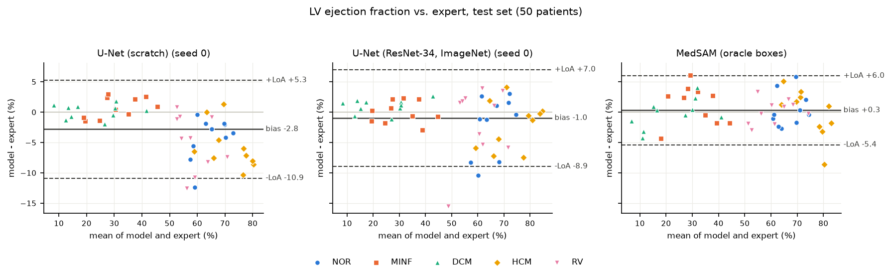

---

## 6. Diagnosis and SHAP for the same patient

`scripts/run_diagnosis.py` trains the diagnosis models once, on the expert features of the 100
training patients, then predicts every test patient from each set of features. The app uses the saved
XGBoost model (`runs/classifier/xgboost.json`) the same way.

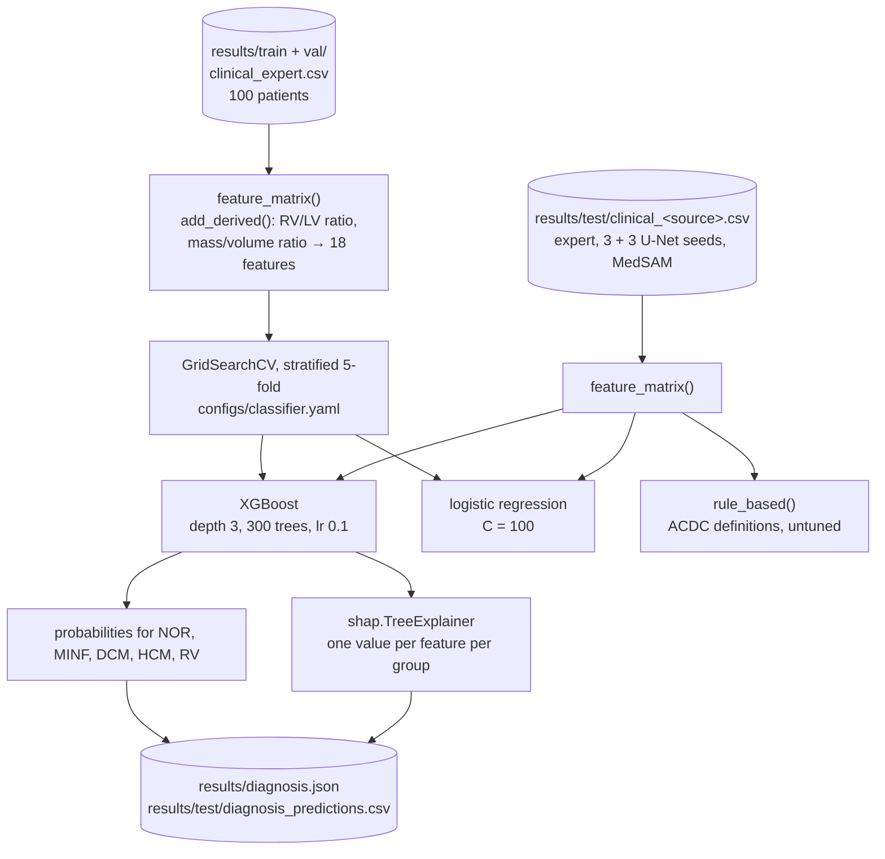

### Patient129, continued

Patient129's true group is "abnormal RV". Here are its features from the expert masks and from the
pretrained U-Net (seed 0), with what the model made of them. The SHAP column is the push towards
"RV", in log-odds; the values for all five groups add up exactly to the model's raw scores.

| | from expert masks | from U-Net masks |
|---|---|---|
| RV/LV volume ratio (EDV) | 1.42 | 1.19 |
| ... its SHAP push towards RV | **+2.64** | **−0.77** |
| RV EF | 36.7 % | 43.8 % |
| RV ESV per body area | 80.9 mL/m² | 59.1 mL/m² |
| P(RV) | **0.993** | **0.455** |
| P(NOR) | 0.002 | 0.377 |
| predicted group | RV | RV, barely |

With the expert's masks, the one feature that settles it is the RV being 1.42 times the size of the LV:
it alone adds +2.64 to the RV score. With the U-Net's masks, the missed basal RV slice from §5 shrinks
the RV, the ratio drops to 1.19, and the same feature now pushes *away* from RV (−0.77) and towards
normal. The model still says RV, but only 46% against 38% for normal. The other seeds' features give
RV again (seed 1), HCM (seed 2); the scratch U-Net's give HCM, NOR and NOR
(`results/test/diagnosis_predictions.csv`).

This is the whole pipeline in one patient: one hard slice near the valve, a 44 mL error in RV volume,
a ratio that crosses the model's threshold, and a diagnosis that becomes a coin toss. It is also why
the app shows the reasons next to the answer: "RV/LV volume ratio pushed away from abnormal RV" points
straight at the measurement to check.

### Over all 50 test patients

| features from | rules | logistic regression | XGBoost |
|---|---|---|---|
| expert masks | 0.70 | 0.88 | 0.86 |
| scratch U-Net (3 seeds) | 0.67 ± 0.03 | 0.85 ± 0.02 | 0.85 ± 0.01 |
| pretrained U-Net (3 seeds) | 0.65 ± 0.01 | 0.91 ± 0.02 | 0.88 ± 0.02 |
| MedSAM, oracle boxes | 0.74 | 0.64 | 0.80 |

Accuracy, from `results/diagnosis.json`. Each patient is 0.02, so differences of one or two patients
are noise. Accuracy hides individual changes, so the same file also records how often a patient gets
the **same** XGBoost diagnosis from predicted features as from expert features: 95% for either U-Net
(mean over seeds), 82% for MedSAM. Patient129 is one of the U-Net cases that stayed the same, but only
just. Most mistakes are MINF and DCM swapped for each other (`figures/diagnosis_confusion.png`):
both are weak, dilated left ventricles, and what tells them apart in the ACDC definitions is abnormal
wall motion in segments, which none of our features measure.

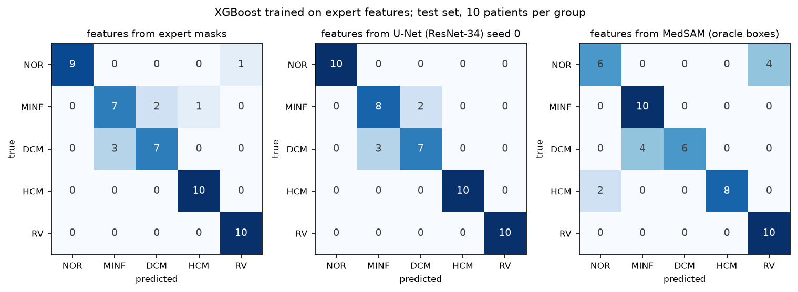

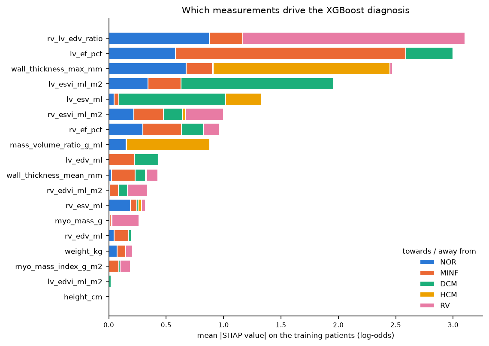

---

## 7. An upload in the app

From the moment a user drops two files to the overlay on screen. The frontend half is written in
Phase 7; the backend half is `backend/app/routes/cases.py` and `services/`.

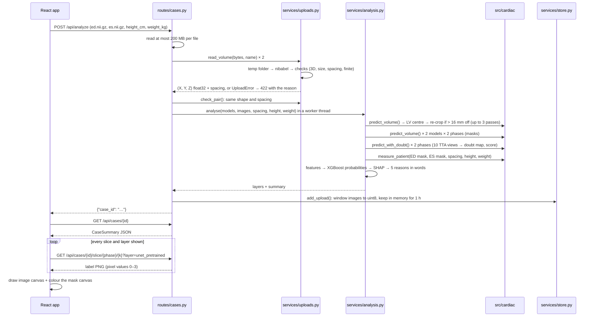

**Re-centring.** The U-Nets were trained on 192 × 192 crops centred on the LV. A scan from another
source may have the heart anywhere. `find_crop_centre()` runs the pretrained U-Net once on the centre
crop, takes the centre of the predicted LV, and if it is more than 16 mm from the image centre, crops
around it and tries again, until the centre moves less than 2 mm (at most 3 passes). On the mirror's
own scans the LV is always near the centre, so nothing moves and the masks are exactly the evaluated
ones. Tested by padding test patient129 to 320 × 320 with the heart near a corner: the off-centre
upload gives the same measurements as the original to the second decimal.

**Timing.** On CPU (Apple M4, 10 threads), the whole analysis for patient129 took about 4 seconds:
2 re-centring passes, 4 single-view predictions and 20 TTA views.

**Samples** take the same path, once, ahead of time: `scripts/cache_sample_cases.py` calls the same
`analyse()` and adds the expert and MedSAM layers and the cine, then saves `data/cache/samples/<pid>`.
`GET /api/samples` lists them and they load instantly.

---

## 8. Report generation

`GET /api/cases/{id}/report.pdf` → `backend/app/report.py`, `build_report(case)`:

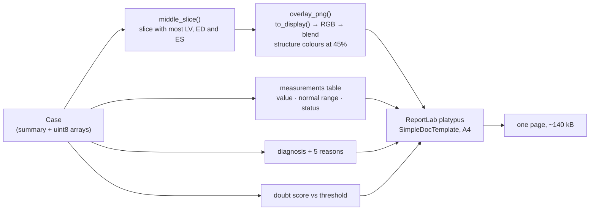

Everything on the report comes from the case summary the app already shows, so the PDF can never
say something the screen doesn't. The footer names the model run and the code version.

---

## 9. The evaluation run that writes `results/`

Segmentation (Phase 3), clinical numbers (Phase 4), then uncertainty and diagnosis (Phase 5).

### 9a. Segmentation

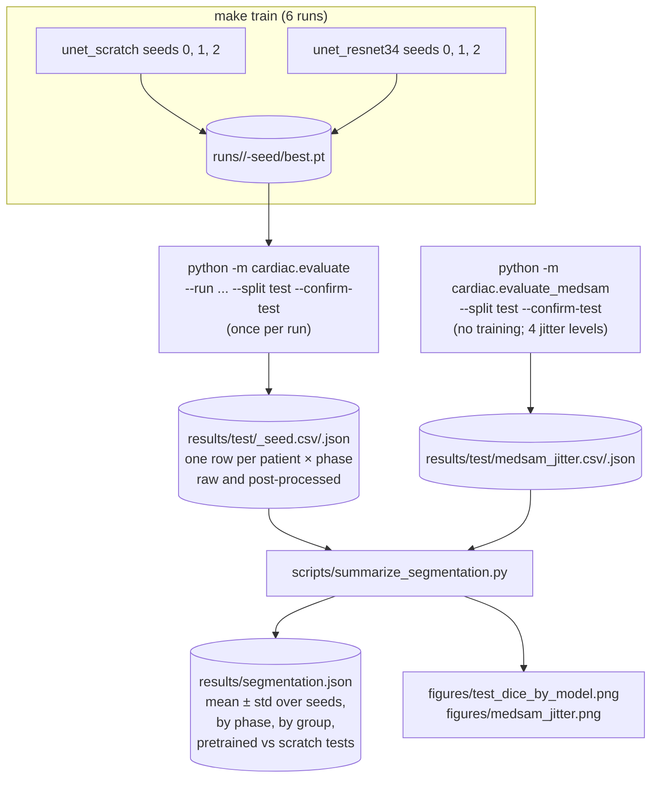

Order of operations, and why:

1. All six U-Net runs were trained and their checkpoints fixed **before** any of them was evaluated on
   test. Nothing about the models was changed after that.
2. MedSAM's protocol (padding, merge order, jitter levels, seed) was fixed after a validation run, then
   run once on test.
3. `cardiac.evaluate` and `cardiac.evaluate_medsam` refuse `--split test` unless `--confirm-test` is
   given, so the test set can't be opened by accident.
4. Every results file records the code version: `train_git_commit` (from the run folder) and
   `eval_git_commit` (read before anything is written). `repro.git_commit()` flags uncommitted changes
   to code or config, but ignores `results/` and `figures/`, which are outputs. An earlier version
   counted those too, so evaluating several runs in a row wrongly flagged the later ones. That was
   fixed, and the affected runs were re-evaluated, giving byte-identical per-patient numbers.
5. `summarize_segmentation.py` only reads the per-run CSVs. It can be re-run at any time without
   touching a model or the test images.

How the numbers in `segmentation.json` are built, for one U-Net:

```
per run:   mean over 100 rows (50 patients × ED/ES) of post-processed Dice  → one score per seed
per model: mean and std of the 3 seed scores                               → "0.928 ± 0.002"
per test:  each patient's Dice averaged over 3 seeds and ED/ES             → 50 numbers per model
           paired Wilcoxon on the 50 differences (pretrained − scratch)   → p-value
```

The "±" in the results table is therefore **training noise** (how much the score moves between seeds),
not patient-to-patient spread, which is much larger (a standard deviation of about 0.04–0.07 Dice,
depending on the structure) and is in the per-run JSON files.

### 9b. Clinical numbers (Phase 4)

`make eval` continues after the segmentation summary:

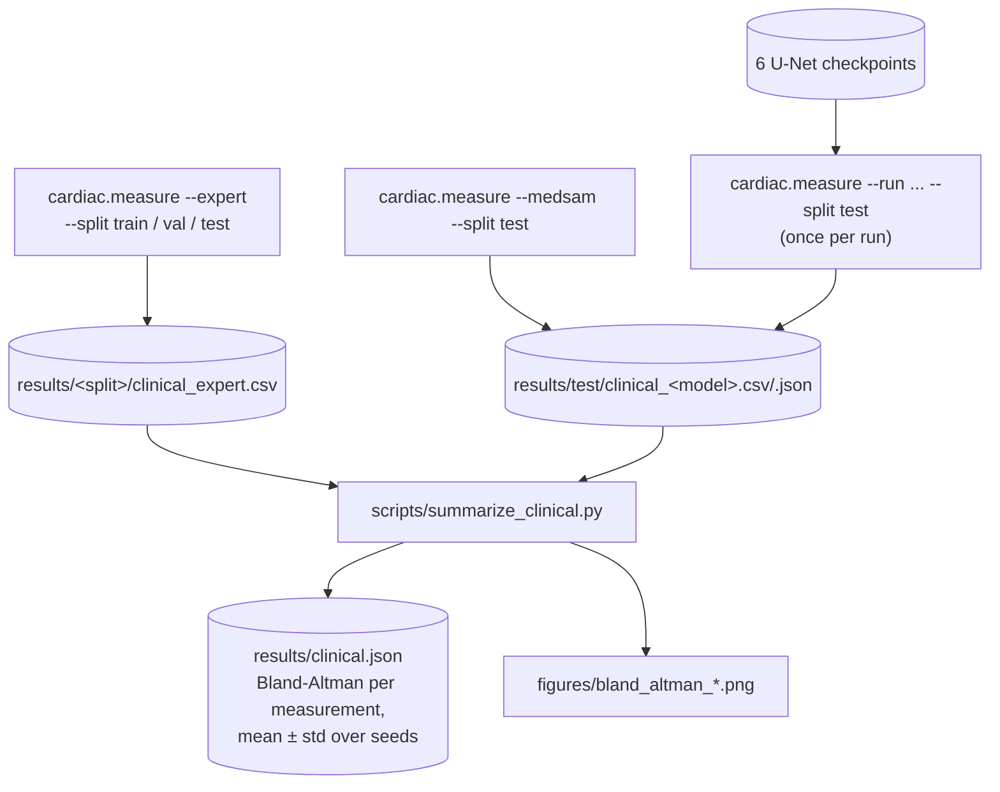

The order matters in the same way as for segmentation:

1. The measurement code was written, unit-tested and run on the **validation** split first
   (`results/clinical_val.json`). The test run used it unchanged (`decisions.md` D23).
2. Predicted masks are recomputed, not stored. Every `clinical_<model>.json` records the largest Dice
   difference from the Phase 3 evaluation of the same model; all are at most 0.00005, which is the
   rounding of the 4-decimal CSV. So the numbers were measured on exactly the masks Phase 3 scored.
3. Expert measurements for the training and validation patients (`results/train/`, `results/val/`)
   are written too: they are the training data for the diagnosis models in Phase 5.

### 9c. Uncertainty and diagnosis (Phase 5)

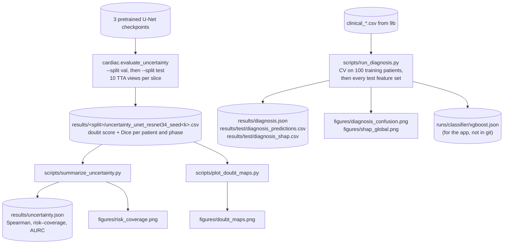

- The TTA views were chosen on validation patients after the plan's 90° rotations failed there
  (`decisions.md` D26); the test run used the final views unchanged.
- The classifier's settings come from cross-validation on the 100 training patients. One grid edge
  was hit twice; the grid was widened once before the test run and not after (D24).
- Two statistics were added after the first test run, as reporting only, without changing any model:
  how often the diagnosis from predicted features equals the one from expert features
  (`agreement_with_expert_features`), and the doubt–error correlation with heart size taken out
  (`spearman_rho_size_adjusted`, marked exploratory).
- `run_diagnosis.py` checks that, for every saved patient, the SHAP values plus the base value add up
  to the model's raw score. shap only updates its base value after computing SHAP values on the same
  explainer, which an earlier version of the script got wrong.

---

## 10. What happens when something goes wrong

Every failure should say what happened in words a user can act on, and nothing should fail silently.

| Situation | Where it's caught | What the user gets |
|---|---|---|
| Not a NIfTI file, or a corrupt one | `uploads.read_volume()` | 422: "ed.nii.gz: could not be read as NIfTI" |
| Wrong extension (e.g. `.png`) | `read_volume()` | 422: "expected a .nii or .nii.gz file" |
| `.nii.gz` name but not gzipped (or the reverse) | `read_volume()` looks at the first two bytes, not the name | works |
| A 4D cine or a 2D image | `read_volume()` | 422: "expected one 3D frame (X, Y, slices), got shape …" |
| Header without voxel spacing | `cardiac.data.io.load_nifti()` | 422: "header has no valid voxel spacing" |
| Implausible size or spacing | `read_volume()` | 422 naming the value and the accepted range |
| ED and ES of different shape or spacing | `uploads.check_pair()` | 422: "ED shape … and ES shape … differ" |
| File over 200 MB | `routes/cases._read()` | 413 |
| Missing height or weight | FastAPI form validation | 422 listing the missing field |
| Trained weights not downloaded | `services/models.load_models()` at startup | the app still starts; `/api/health` shows the reason, samples and metrics work, uploads answer 503 with "models are not loaded: …" |
| `results/` files missing | `/api/metrics/summary` | 503 naming the file |
| Unknown or expired case id | `routes/cases._case()` | 404: "uploaded cases expire after an hour" |
| Slice, frame or layer out of range | `get_slice()`, `get_cine()` | 404 naming the range |
| torch and xgboost in one process | `backend/app/__init__.py` | prevented: OpenMP starts single-threaded (D28) |

`tests/test_api.py` covers the upload checks, unknown cases and layers, missing models and the
metrics endpoint, with small stand-in models so the tests don't need trained weights.
