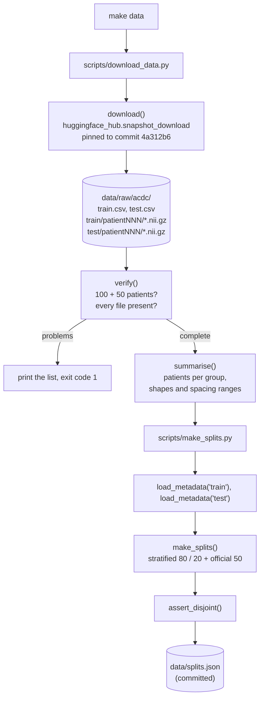
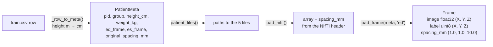
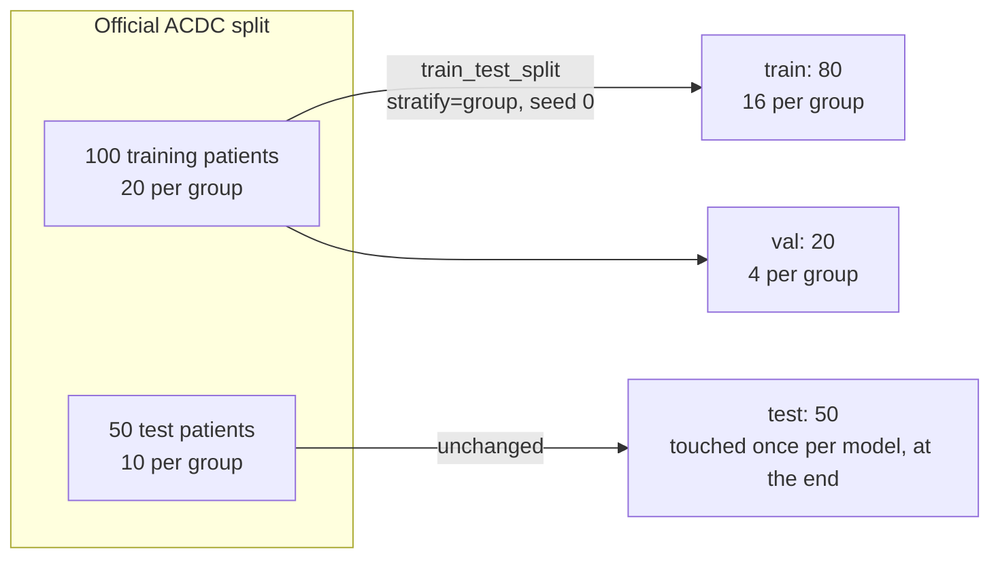
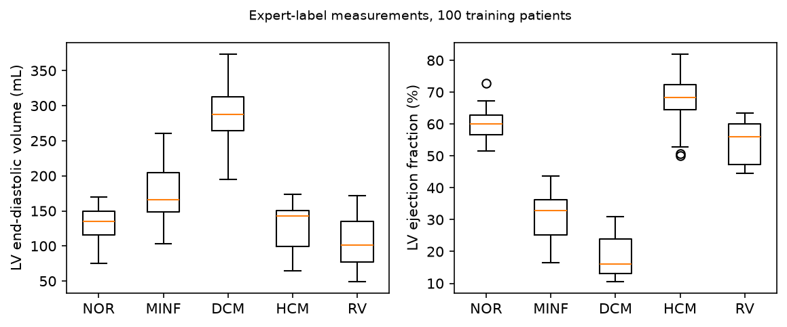
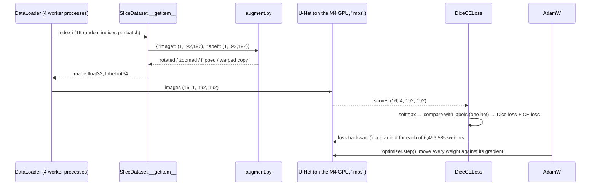
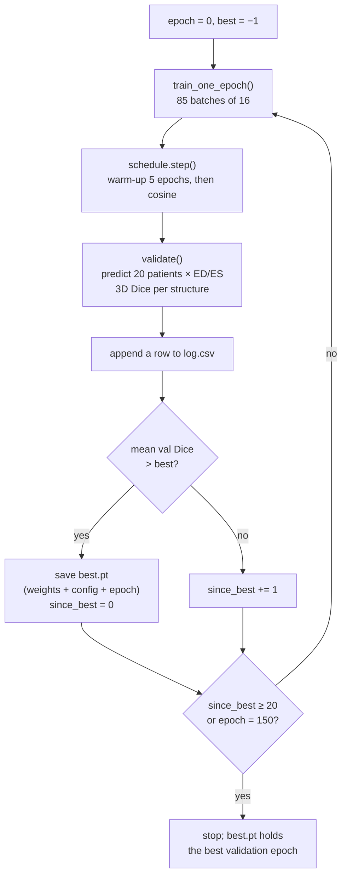
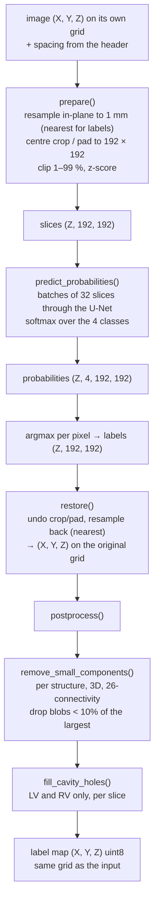

# Execution flow

This file follows real execution through the code, step by step, with file and function names. Read it
next to the code. Each section is written in the phase that builds that part of the pipeline.

1. [`make data`: download, verify, split](#1-make-data-download-verify-split) (Phase 1)
2. One training step, from NIfTI file to gradient update (Phase 2)
3. A full training run with early stopping (Phase 2)
4. Inference on one patient (Phase 2)
5. Clinical calculation, worked example (Phase 4)
6. Diagnosis and SHAP for the same patient (Phase 5)
7. An upload in the app (Phase 6)
8. Report generation (Phase 6)
9. The evaluation run that writes `results/` (Phases 3–5)
10. What happens when something goes wrong (Phase 6)

---

## 1. `make data`: download, verify, split

`make data` runs two scripts, one after the other, both inside `.venv/` through `uv run`:



### 1a. Download

`download()` in `scripts/download_data.py` calls `snapshot_download` with a list of file patterns. It is
pinned to one commit of the dataset (`REVISION`), so running it next year fetches byte-identical files.
Files already on disk from an earlier run are not fetched again. With `--no-cine`
(`make data-lite`) it skips the 4D cine files, which are about 1 GB of the 1.1 GB total; training doesn't
need them, only the app's playback does.

What lands on disk, per patient:

```
data/raw/acdc/train/patient001/
├── patient001_sax_ed.nii.gz      3D image at end-diastole   (192, 192, 10)  float, 0–255
├── patient001_sax_ed_gt.nii.gz   expert labels at ED        (192, 192, 10)  0 bg, 1 RV, 2 MYO, 3 LV
├── patient001_sax_es.nii.gz      3D image at end-systole
├── patient001_sax_es_gt.nii.gz   expert labels at ES
└── patient001_sax_t.nii.gz       4D cine, the whole beat     (192, 192, 10, 30)
```

`sax` means short-axis: each slice cuts across the heart, like slicing a loaf of bread.

### 1b. Reading a patient (`src/cardiac/data/io.py`)

Everything else in the project reads data through three functions:



`load_frame` does more than read. It refuses to return a frame if the image and label shapes differ, if
their spacings differ, if the header has no valid spacing, or if the label contains any value other than
0–3. A broken file fails here, loudly, instead of quietly producing a wrong volume three steps later.

The spacing always comes from the file header (`load_nifti`), never from a constant in the code. This is
why the same code would work on the official ACDC data, where every patient has a different spacing.

### 1c. Verify and summarise

`verify()` loads both CSVs and checks that every expected file exists. `summarise()` then opens every ED
image to print the real shapes and spacings. This is the output on the pinned mirror:

```
All expected files are present.

train: 100 patients
  per group: NOR 20, MINF 20, DCM 20, HCM 20, RV 20
  mirror shape (X, Y, Z)   192-192  192-192  5-11
  mirror spacing mm        1-1  1-1  10-10
  original spacing mm      0.703125-1.91964  0.703125-1.91964  5-10
  patients whose original slices were thinner than 10 mm: 14

test: 50 patients
  per group: NOR 10, MINF 10, DCM 10, HCM 10, RV 10
  mirror shape (X, Y, Z)   192-192  192-192  6-11
  mirror spacing mm        1-1  1-1  10-10
  original spacing mm      1.36719-1.95312  1.36719-1.95312  5-10
  patients whose original slices were thinner than 10 mm: 9
```

Two things to notice. Every scan in the mirror has the same spacing, but the originals did not (that's
the resampling described in `decisions.md` D9). And the number of slices varies from 5 to 11, because
hearts are different heights; the model works on one slice at a time, so this doesn't matter for
training, but every volume is a sum over however many slices a patient has.

### 1d. Splits (`scripts/make_splits.py`, `src/cardiac/data/splits.py`)



`make_splits()` uses scikit-learn's `train_test_split` with `stratify=groups`, which guarantees each group
contributes exactly 4 validation patients. The official test patients pass straight through.
`assert_disjoint()` then checks that no id appears in two splits (and none appears twice in one split)
before anything is written. Output:

```
Wrote data/splits.json
  train  80 patients  (NOR 16, MINF 16, DCM 16, HCM 16, RV 16)
  val    20 patients  (NOR 4, MINF 4, DCM 4, HCM 4, RV 4)
  test   50 patients  (NOR 10, MINF 10, DCM 10, HCM 10, RV 10)
```

`data/splits.json` holds only patient ids plus a `provenance` block (seed and rule). It is the one file
in `data/` that is committed, so every later phase, on any machine, uses the same patients for the same
purpose. `load_splits()` re-checks disjointness every time the file is read.

### 1e. Tests that guard this step

| Test | What it protects against |
|---|---|
| `tests/test_splits.py::test_no_patient_in_two_splits` | Data leakage between train, val and test |
| `tests/test_splits.py::test_sizes_and_stratification` | A validation set missing a disease |
| `tests/test_splits.py::test_committed_splits_file_is_disjoint_and_complete` | Someone hand-editing `splits.json` |
| `tests/test_io.py::test_spacing_comes_from_header` | Volumes computed from a hard-coded spacing |
| `tests/test_io.py::test_unknown_label_value_is_rejected` | A corrupted label file slipping through |

The I/O tests build tiny synthetic NIfTI files in a temporary folder, so they run in a second without the
real dataset.

### 1f. Looking at the data

`notebooks/01_data_exploration.ipynb` (`make explore`) reads only the 100 training patients and saves
five figures to `figures/`. The one that matters most for later phases:



These are computed from the expert masks, not from any model. Dilated hearts (DCM) are big and pump
weakly; hypertrophic hearts (HCM) pump strongly; previous infarction (MINF) sits in between. If the
segmentation is good, the diagnosis classifier in Phase 5 has a clear signal to work with.

---

## 2. One training step, from a NIfTI file to a gradient update

Command: `make train`, which runs `uv run python -m cardiac.train --config configs/unet_scratch.yaml`.

Before the first step, everything is loaded once and kept in memory:

```mermaid
sequenceDiagram
    participant T as train.py
    participant C as config.py
    participant S as splits.py
    participant IO as io.py
    participant P as preprocess.py
    participant DS as dataset.py
    T->>C: load_config("configs/unet_scratch.yaml")
    C-->>T: Config (typed; unknown keys are an error)
    T->>T: set_seed(0), make_run_dir() → runs/unet_scratch/<time>-seed0/
    T->>S: load_splits("data/splits.json")
    S-->>T: 80 train ids, 20 val ids (re-checked for overlap)
    loop each patient × {ED, ES}
        T->>IO: load_frame(root, meta, phase)
        IO-->>T: image (192,192,Z) float32, label uint8, spacing (1,1,10)
        T->>P: prepare(image, spacing, label)
        P-->>T: slices (Z,192,192) z-scored, labels (Z,192,192)
    end
    T->>DS: SliceDataset(train volumes, training_transforms())
    DS-->>T: 1,372 slices, as arrays (1372, 1, 192, 192)
```

Then one training step, on one batch:



Shapes at each stage:

| Stage | Shape | dtype | Where |
|---|---|---|---|
| NIfTI image on disk | (192, 192, Z), Z = 5–11 | float | `load_nifti` |
| after `prepare` | (Z, 192, 192) | float32, mean 0, std 1 | `preprocess.py` |
| one dataset item | (1, 192, 192) | float32 / int64 | `SliceDataset.__getitem__` |
| one batch | (16, 1, 192, 192) | float32 | `DataLoader` |
| model output | (16, 4, 192, 192) | float32 scores | `UNet.forward` |
| loss | () a single number | float32 | `DiceCELoss` |

## 3. A full training run with early stopping



Validation is done the same way the final numbers are reported: whole 3D volumes, one Dice per
structure per patient per phase, then averaged. Checkpoints are chosen on these 3D scores, not on
per-slice scores. Validation during training skips post-processing to keep it fast; the evaluation
step below measures both.

Each run folder holds:

```
runs/unet_scratch/20261122-185431-seed0/
├── config.yaml       the exact settings used
├── git_commit.txt    the code version (and a note if there were uncommitted changes)
├── log.csv           one row per epoch: lr, train loss, val Dice per structure, seconds
└── best.pt           weights from the best validation epoch (never committed to git)
```

## 4. Inference on one patient

`predict_volume()` in `src/cardiac/infer.py`, as used by `cardiac.evaluate` and later by the app:



Two details matter:

- **Predictions go back to the original grid before anything is measured.** Dice, HD95 and every
  volume are computed on the scan's own voxels with its own spacing. On the mirror this is the identity
  (it is already 1 mm, 192 × 192), but `tests/test_preprocess.py` checks the round trip for crop, pad
  and resample cases, because uploads in the app won't be.
- **Post-processing never fills the myocardium.** The myocardium is a ring around the LV; filling its
  "hole" would swallow the LV. Only the two cavities are filled, and only where the hole is background.

Evaluation (`uv run python -m cardiac.evaluate --run <run folder> --split val`) runs this for every
validation patient and phase, both with and without `postprocess()`, and writes per-patient rows to
`results/val/<name>_seed<k>.csv` plus mean ± std per structure, phase and group to the matching
`.json`. The headline numbers are post-processed; the raw ones are kept to measure what
post-processing actually changes.
