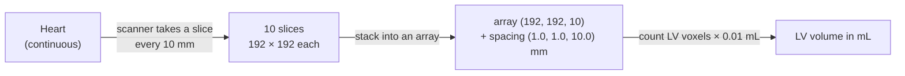
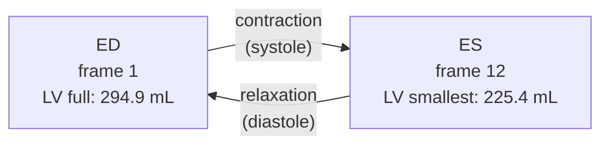

# ML basics for this project

This file explains, from zero, every idea the rest of the project depends on. It assumes you know Python
and have seen a neural network diagram once. Nothing more.

Each concept follows the same pattern:

1. **What it is**, in plain words.
2. **Why we need it here**, tied to cardiac MRI.
3. **A picture or analogy**, usually a Mermaid diagram or a small worked example with real numbers.
4. **Where it lives in our code**, with the file and function name.

Sections are filled in during the phase that first uses the idea, so the explanations always match code
that exists. The outline below shows what is coming and when. If a section has only its one-line summary,
the code for it has not been written yet.

## Outline

| # | Section | What it will explain | Written in |
|---|---|---|---|
| 1 | What an image is to a computer | A grid of numbers; greyscale vs colour; `dtype` and value ranges | Phase 1 |
| 2 | MRI volumes and voxel spacing | A 3D stack of slices; why a voxel is a box in millimetres, not a dot; why thick slices matter | Phase 1 |
| 3 | Cine MRI, end-diastole and end-systole | A 4D scan is a movie of one heartbeat; the two frames we label and why | Phase 1 |
| 4 | Segmentation vs classification | One label per image vs one label per pixel; our four labels (background, RV, myocardium, LV) | Phase 2 |
| 5 | Convolution | A 3×3 filter sliding over a 5×5 image, worked by hand | Phase 2 |
| 6 | Pooling and upsampling | Shrinking to see more context, growing back to draw outlines | Phase 2 |
| 7 | The U-Net | Encoder, decoder and skip connections, drawn with the channel sizes we actually use | Phase 2 |
| 8 | Loss functions | Dice derived by hand on a 4×4 example; cross-entropy as "how surprised was the model" | Phase 2 |
| 9 | The training loop | Forward → loss → backward → optimiser step, and what an epoch is | Phase 2 |
| 10 | Overfitting and validation | Why we hold patients back, and why we split by patient instead of by slice | Phase 2 |
| 11 | Data augmentation | Teaching the model that a slightly rotated heart is still a heart | Phase 2 |
| 12 | Transfer learning | Reusing an encoder trained on everyday photos for grey MRI slices | Phase 3 |
| 13 | Foundation models and prompting | What MedSAM is, what a box prompt is, and why it needs no training | Phase 3 |
| 14 | From masks to millimetres | Counting voxels, multiplying by spacing, and getting millilitres | Phase 4 |
| 15 | Decision trees and gradient boosting | One tree as a flowchart of questions; many small trees correcting each other | Phase 5 |
| 16 | SHAP values | How much each measurement pushed one patient's prediction, and in which direction | Phase 5 |
| 17 | Uncertainty | Why a model can be confidently wrong; test-time augmentation and entropy as a "doubt map" | Phase 5 |

## How to read the rest of the docs

- `architecture.md` describes what the pieces are and how they connect.
- `flow.md` follows real execution step by step, with file and function names.
- `decisions.md` records every design choice: the options, what I picked, and what I gave up.

Start here, then read `flow.md` alongside the code.

---

## 1. What an image is to a computer

**What it is.** To a computer, a greyscale image is a grid of numbers, one per pixel. Bigger number,
brighter pixel. Nothing else: no edges, no shapes, no "heart". Everything a model learns, it learns
from patterns in these numbers.

Here is a real 6 × 6 patch from patient001 (end-diastole, slice 4), taken where the bright blood
inside the LV meets the darker heart muscle:

```
image (brightness)                          expert label (3 = LV cavity, 2 = myocardium)
          column →
row  ↓    0    1    2    3    4    5
     0  [  79,  69,  63,  59,  60,  56 ]      0  [ 3, 3, 3, 2, 2, 2 ]
     1  [  75,  66,  62,  60,  61,  56 ]      1  [ 3, 3, 3, 2, 2, 2 ]
     2  [  76,  66,  60,  57,  60,  60 ]      2  [ 3, 3, 3, 2, 2, 2 ]
     3  [  79,  66,  58,  54,  60,  63 ]      3  [ 3, 3, 3, 2, 2, 2 ]
     4  [  85,  70,  59,  53,  61,  65 ]      4  [ 3, 3, 3, 2, 2, 2 ]
     5  [  94,  76,  63,  56,  62,  64 ]      5  [ 3, 3, 3, 2, 2, 2 ]
```

Blood is brighter than muscle on this kind of MRI, and the left columns (75–94) are clearly blood. But
look at column 2: the expert labelled it blood, yet its values (58–63) are no brighter than the muscle
next to it. A real boundary is a gradual blur, not a step, and the expert placed the line using the
shape of the whole ventricle, not these 36 numbers alone. That is why the model needs to see a wide
area around each pixel (section 7, the U-Net). Its whole job is to produce the right-hand grid from the
left-hand one, for every pixel.

In NumPy this is an array with a **shape** (how many numbers along each axis) and a **dtype** (what kind
of number). Our images are `float32` with values from 0 to 255; our labels are `uint8` (whole numbers
0–255, though we only use 0–3).

**Why we need it here.** Every step of the project is arithmetic on these grids: normalising
brightness, convolving filters over them, comparing predicted labels to expert labels pixel by pixel.

**Where it lives in our code.** `load_frame()` in `src/cardiac/data/io.py` returns `frame.image` (the
numbers) and `frame.label` (the answer, one label per pixel).

---

## 2. MRI volumes and voxel spacing

**What it is.** An MRI scan of the heart is not one image but a **stack** of 2D slices, so the array is 3D:
`(X, Y, Z)` = `(192, 192, 10)` for a typical patient, meaning 10 slices of 192 × 192 pixels. A 3D pixel is
called a **voxel**.

The key idea: **a voxel is a small box with a real size in millimetres**, not a dimensionless dot. That
size is the **voxel spacing**, stored in the file header.

```
        one voxel in our data

          1 mm
        ┌──────┐
       ╱      ╱│
      ╱      ╱ │
     ┌──────┐  │ 10 mm      volume = 1 × 1 × 10 = 10 mm³ = 0.01 mL
1 mm │      │  │            (1 mL = 1000 mm³)
     │      │ ╱
     │      │╱
     └──────┘
```

The boxes are **10 times taller than they are wide**. The scanner takes thin pictures 10 mm apart and
nothing in between, like slicing a loaf of bread into thick slices.



**Why we need it here.** Clinical numbers are physical. If the LV takes up 29,490 voxels (patient001 at
end-diastole), its volume is 29,490 × 0.01 mL = **294.9 mL**. On a scanner with 1.5 mm pixels the same heart
would take up fewer voxels, but each would be bigger; only *count × voxel volume* gives the same answer on
both. Using the pixel count alone would make the same heart's volume depend on which scanner took it.

The original ACDC scans had pixels from 0.7 to 1.9 mm wide. The copy of ACDC we use resampled all of them
to 1 × 1 × 10 mm (`decisions.md` D9), but the code still reads the spacing from every file, so it would
work on the originals too.

**Where it lives in our code.** `load_nifti()` in `src/cardiac/data/io.py` reads the spacing from the
NIfTI header and refuses files that don't have one. `figures/data_original_spacing.png` shows how much
the original spacing varied.

---

## 3. Cine MRI, end-diastole and end-systole

**What it is.** A **cine** MRI is a movie of one heartbeat: the same stack of slices captured at about 30
moments (frames) across the cardiac cycle. Our cine arrays are 4D: `(192, 192, 10, 30)`, which is
`(X, Y, slice, time)`.

Two frames matter most:

- **End-diastole (ED):** the heart is fully relaxed and filled with blood. The ventricles are at their
  largest.
- **End-systole (ES):** the heart has finished squeezing. The ventricles are at their smallest.



The numbers are patient001's LV volumes from the expert labels. Only these two frames are labelled by
experts in ACDC, because together they give the most important heart measurement:

```
ejection fraction = (EDV − ESV) / EDV × 100
                  = (294.9 − 225.4) / 294.9 × 100 ≈ 23.6 %
```

A healthy LV pumps out roughly 55–70% of its blood each beat. Patient001 has dilated cardiomyopathy
(DCM): a big, weak heart, which is exactly what 23.6% looks like.

One subtlety that shows up in our data: the heart doesn't just shrink at ES, it also **moves**. The base
(the top, near the valves) pulls down towards the apex. So "slice 3 at ED" and "slice 3 at ES" are not the
same piece of heart; a slice near the base can contain ventricle at ED and nothing at ES. You can see
this in the HCM row of `figures/data_groups_ed_es.png`. It's one reason every measurement is computed
from whole 3D stacks rather than matching slices one to one.

**Where it lives in our code.** `PatientMeta.ed_frame` / `es_frame` hold the frame numbers;
`load_frame(root, meta, "ed")` and `load_frame(root, meta, "es")` load the labelled frames;
`patient_files(...)["cine"]` is the 4D movie the app plays.
