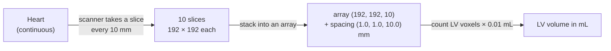
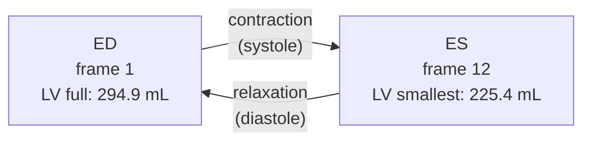
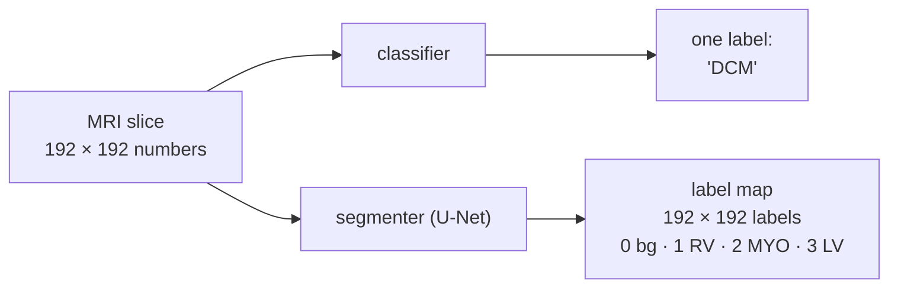
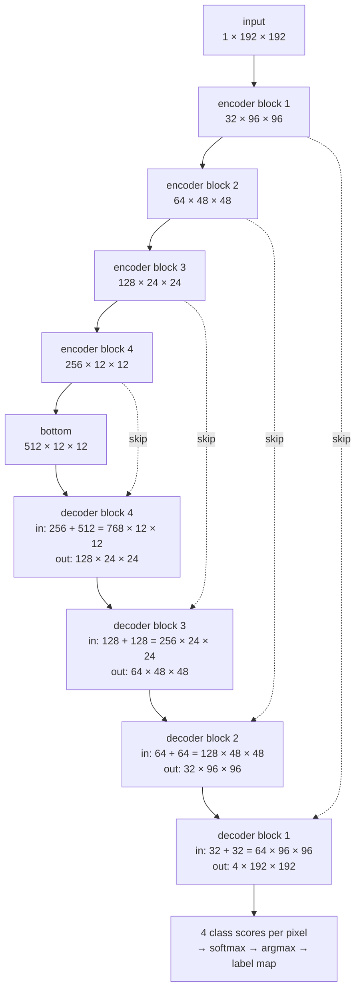
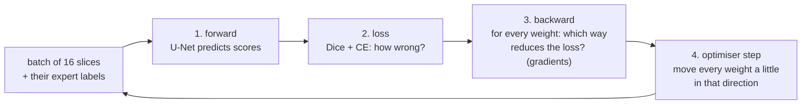
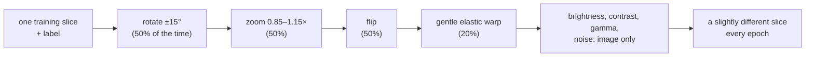
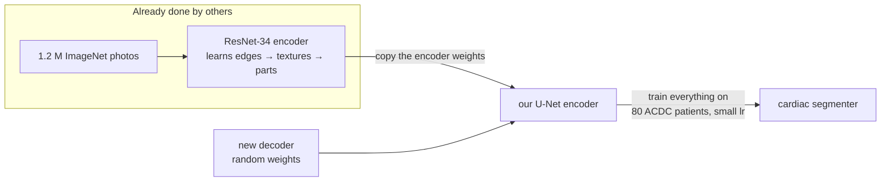
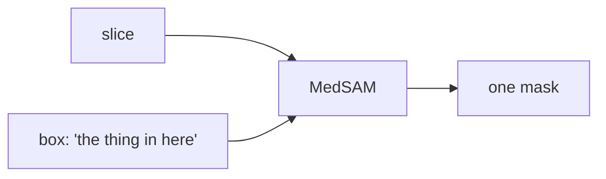
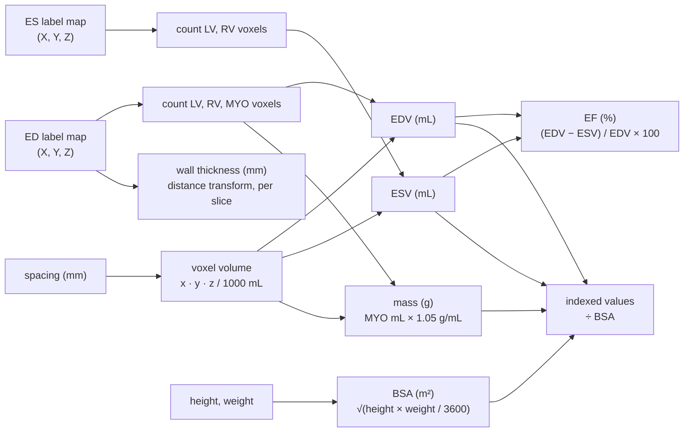
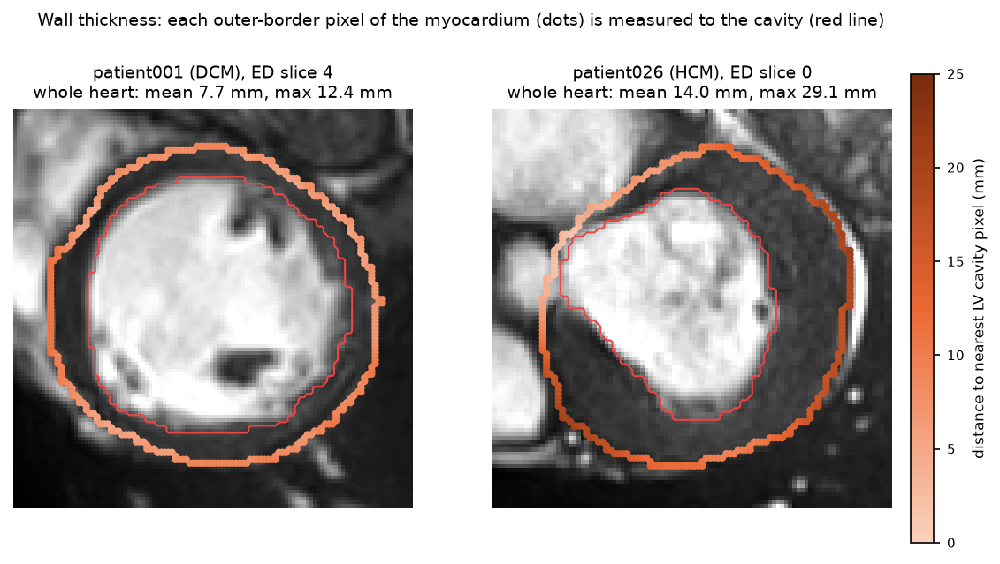

# ML basics for this project

This file explains, from zero, every idea the rest of the project depends on. It assumes you know Python
and have seen a neural network diagram once. Nothing more.

Each concept follows the same pattern:

1. **What it is**, in plain words.
2. **Why we need it here**, tied to cardiac MRI.
3. **A picture or analogy**, usually a Mermaid diagram or a small worked example with real numbers.
4. **Where it lives in our code**, with the file and function name.

Sections are filled in during the phase that first uses the idea, so the explanations always match code
that exists. The outline below shows what is coming and when. If a section has only its one-line summary,
the code for it has not been written yet.

## Outline

| # | Section | What it will explain | Written in |
|---|---|---|---|
| 1 | What an image is to a computer | A grid of numbers; greyscale vs colour; `dtype` and value ranges | Phase 1 |
| 2 | MRI volumes and voxel spacing | A 3D stack of slices; why a voxel is a box in millimetres, not a dot; why thick slices matter | Phase 1 |
| 3 | Cine MRI, end-diastole and end-systole | A 4D scan is a movie of one heartbeat; the two frames we label and why | Phase 1 |
| 4 | Segmentation vs classification | One label per image vs one label per pixel; our four labels (background, RV, myocardium, LV) | Phase 2 |
| 5 | Convolution | A 3×3 filter sliding over a 5×5 image, worked by hand | Phase 2 |
| 6 | Pooling and upsampling | Shrinking to see more context, growing back to draw outlines | Phase 2 |
| 7 | The U-Net | Encoder, decoder and skip connections, drawn with the channel sizes we actually use | Phase 2 |
| 8 | Loss functions | Dice derived by hand on a 4×4 example; cross-entropy as "how surprised was the model" | Phase 2 |
| 9 | The training loop | Forward → loss → backward → optimiser step, and what an epoch is | Phase 2 |
| 10 | Overfitting and validation | Why we hold patients back, and why we split by patient instead of by slice | Phase 2 |
| 11 | Data augmentation | Teaching the model that a slightly rotated heart is still a heart | Phase 2 |
| 12 | Transfer learning | Reusing an encoder trained on everyday photos for grey MRI slices | Phase 3 |
| 13 | Foundation models and prompting | What MedSAM is, what a box prompt is, and why it needs no training | Phase 3 |
| 14 | From masks to millimetres | Counting voxels, multiplying by spacing, and getting millilitres | Phase 4 |
| 15 | Decision trees and gradient boosting | One tree as a flowchart of questions; many small trees correcting each other | Phase 5 |
| 16 | SHAP values | How much each measurement pushed one patient's prediction, and in which direction | Phase 5 |
| 17 | Uncertainty | Why a model can be confidently wrong; test-time augmentation and entropy as a "doubt map" | Phase 5 |

## How to read the rest of the docs

- `architecture.md` describes what the pieces are and how they connect.
- `flow.md` follows real execution step by step, with file and function names.
- `decisions.md` records every design choice: the options, what I picked, and what I gave up.

Start here, then read `flow.md` alongside the code.

---

## 1. What an image is to a computer

**What it is.** To a computer, a greyscale image is a grid of numbers, one per pixel. Bigger number,
brighter pixel. Nothing else: no edges, no shapes, no "heart". Everything a model learns, it learns
from patterns in these numbers.

Here is a real 6 × 6 patch from patient001 (end-diastole, slice 4), taken where the bright blood
inside the LV meets the darker heart muscle:

```
image (brightness)                          expert label (3 = LV cavity, 2 = myocardium)
          column →
row  ↓    0    1    2    3    4    5
     0  [  79,  69,  63,  59,  60,  56 ]      0  [ 3, 3, 3, 2, 2, 2 ]
     1  [  75,  66,  62,  60,  61,  56 ]      1  [ 3, 3, 3, 2, 2, 2 ]
     2  [  76,  66,  60,  57,  60,  60 ]      2  [ 3, 3, 3, 2, 2, 2 ]
     3  [  79,  66,  58,  54,  60,  63 ]      3  [ 3, 3, 3, 2, 2, 2 ]
     4  [  85,  70,  59,  53,  61,  65 ]      4  [ 3, 3, 3, 2, 2, 2 ]
     5  [  94,  76,  63,  56,  62,  64 ]      5  [ 3, 3, 3, 2, 2, 2 ]
```

Blood is brighter than muscle on this kind of MRI, and the left columns (75–94) are clearly blood. But
look at column 2: the expert labelled it blood, yet its values (58–63) are no brighter than the muscle
next to it. A real boundary is a gradual blur, not a step, and the expert placed the line using the
shape of the whole ventricle, not these 36 numbers alone. That is why the model needs to see a wide
area around each pixel (section 7, the U-Net). Its whole job is to produce the right-hand grid from the
left-hand one, for every pixel.

In NumPy this is an array with a **shape** (how many numbers along each axis) and a **dtype** (what kind
of number). Our images are `float32` with values from 0 to 255; our labels are `uint8` (whole numbers
0–255, though we only use 0–3).

**Why we need it here.** Every step of the project is arithmetic on these grids: normalising
brightness, convolving filters over them, comparing predicted labels to expert labels pixel by pixel.

**Where it lives in our code.** `load_frame()` in `src/cardiac/data/io.py` returns `frame.image` (the
numbers) and `frame.label` (the answer, one label per pixel).

---

## 2. MRI volumes and voxel spacing

**What it is.** An MRI scan of the heart is not one image but a **stack** of 2D slices, so the array is 3D:
`(X, Y, Z)` = `(192, 192, 10)` for a typical patient, meaning 10 slices of 192 × 192 pixels. A 3D pixel is
called a **voxel**.

The key idea: **a voxel is a small box with a real size in millimetres**, not a dimensionless dot. That
size is the **voxel spacing**, stored in the file header.

```
        one voxel in our data

          1 mm
        ┌──────┐
       ╱      ╱│
      ╱      ╱ │
     ┌──────┐  │ 10 mm      volume = 1 × 1 × 10 = 10 mm³ = 0.01 mL
1 mm │      │  │            (1 mL = 1000 mm³)
     │      │ ╱
     │      │╱
     └──────┘
```

The boxes are **10 times taller than they are wide**. The scanner takes thin pictures 10 mm apart and
nothing in between, like slicing a loaf of bread into thick slices.



**Why we need it here.** Clinical numbers are physical. If the LV takes up 29,490 voxels (patient001 at
end-diastole), its volume is 29,490 × 0.01 mL = **294.9 mL**. On a scanner with 1.5 mm pixels the same heart
would take up fewer voxels, but each would be bigger; only *count × voxel volume* gives the same answer on
both. Using the pixel count alone would make the same heart's volume depend on which scanner took it.

The original ACDC scans had pixels from 0.7 to 1.9 mm wide. The copy of ACDC we use resampled all of them
to 1 × 1 × 10 mm (`decisions.md` D9), but the code still reads the spacing from every file, so it would
work on the originals too.

**Where it lives in our code.** `load_nifti()` in `src/cardiac/data/io.py` reads the spacing from the
NIfTI header and refuses files that don't have one. `figures/data_original_spacing.png` shows how much
the original spacing varied.

---

## 3. Cine MRI, end-diastole and end-systole

**What it is.** A **cine** MRI is a movie of one heartbeat: the same stack of slices captured at about 30
moments (frames) across the cardiac cycle. Our cine arrays are 4D: `(192, 192, 10, 30)`, which is
`(X, Y, slice, time)`.

Two frames matter most:

- **End-diastole (ED):** the heart is fully relaxed and filled with blood. The ventricles are at their
  largest.
- **End-systole (ES):** the heart has finished squeezing. The ventricles are at their smallest.



The numbers are patient001's LV volumes from the expert labels. Only these two frames are labelled by
experts in ACDC, because together they give the most important heart measurement:

```
ejection fraction = (EDV − ESV) / EDV × 100
                  = (294.9 − 225.4) / 294.9 × 100 ≈ 23.6 %
```

A healthy LV pumps out roughly 55–70% of its blood each beat. Patient001 has dilated cardiomyopathy
(DCM): a big, weak heart, which is exactly what 23.6% looks like.

One subtlety that shows up in our data: the heart doesn't just shrink at ES, it also **moves**. The base
(the top, near the valves) pulls down towards the apex. So "slice 3 at ED" and "slice 3 at ES" are not the
same piece of heart; a slice near the base can contain ventricle at ED and nothing at ES. You can see
this in the HCM row of `figures/data_groups_ed_es.png`. It's one reason every measurement is computed
from whole 3D stacks rather than matching slices one to one.

**Where it lives in our code.** `PatientMeta.ed_frame` / `es_frame` hold the frame numbers;
`load_frame(root, meta, "ed")` and `load_frame(root, meta, "es")` load the labelled frames;
`patient_files(...)["cine"]` is the 4D movie the app plays.

---

## 4. Segmentation vs classification

**What it is.** **Classification** gives one answer per image ("this scan shows DCM"). **Segmentation**
gives one answer per *pixel* ("this pixel is LV cavity, this one is myocardium, this one is
background"). A segmentation model outputs an image the same size as its input, where every pixel holds
a class.



Under the hood, the segmenter outputs 4 numbers per pixel, one score for each class: an array of shape
`(4, 192, 192)`. The predicted label is whichever class scores highest at that pixel (`argmax`).

**Why we need it here.** Cardiologists don't want a diagnosis from a black box. They want volumes and
ejection fraction, which need outlines. This project does both, in that order: segment first, measure,
then classify from the measurements (Phase 5).

**Where it lives in our code.** `predict_probabilities()` in `src/cardiac/infer.py` returns the
`(slices, 4, 192, 192)` scores; `predict_volume()` takes the `argmax` and returns the label map.

---

## 5. Convolution

**What it is.** A convolution slides a small grid of weights, the **kernel** (or filter), across the
image. At each position it multiplies the kernel by the pixels underneath, adds the products up, and
writes that one number to the output. Small, local, and repeated everywhere.

A worked example. A 5 × 5 image with a dark region on the left (1) and a bright region on the right (8),
and a 3 × 3 kernel that compares the right side of a window with its left side:

```
image (5 × 5)              kernel (3 × 3)
1  1  1  8  8              -1  0  +1
1  1  1  8  8              -1  0  +1
1  1  1  8  8              -1  0  +1
1  1  1  8  8
1  1  1  8  8
```

Put the kernel over the top-left 3 × 3 window (columns 0–2, all 1s):

```
(-1·1 + 0·1 + 1·1) × 3 rows = 0          nothing changes left-to-right here → 0
```

Slide one column right (columns 1–3, i.e. `1 1 8` in each row):

```
(-1·1 + 0·1 + 1·8) × 3 rows = 7 × 3 = 21    dark-to-bright edge → big number
```

Doing this at all 9 positions gives a 3 × 3 output:

```
0  21  21
0  21  21
0  21  21
```

The kernel has become an **edge detector**: it lights up exactly where dark meets bright. Nobody tells a
neural network to use this kernel. Its weights start random and training adjusts them until they detect
whatever patterns help the task. The first layers learn edges like this; deeper layers combine edges into
curves, curves into rings, rings into "this looks like the LV wall".

**Why we need it here.** The boundary between blood and heart muscle is a brightness edge (section 1),
so edge-like filters are exactly what the first layers need. And because the same kernel slides
everywhere, the network finds an edge wherever it is in the image, with very few weights.

**Where it lives in our code.** Inside MONAI's `UNet` (`src/cardiac/models/unet.py`), every block is a
pair of 3 × 3 convolutions. Our network has about 6.5 million learnable weights in total.

---

## 6. Pooling and upsampling

**What it is.** To understand a whole heart, the network needs to see a big area at once. A 3 × 3 kernel
only sees 3 pixels. The fix is to **shrink** the image step by step, so a 3 × 3 kernel on a shrunk image
covers a much larger area of the original.

Classic **max pooling** keeps the largest value of each 2 × 2 block:

```
1 3 | 2 0
4 2 | 1 1          max of each 2 × 2 block        4 2
----+----        ─────────────────────────▶       2 7
0 1 | 5 6
2 2 | 7 1
```

Our U-Net shrinks with **stride-2 convolutions** instead: the kernel jumps 2 pixels at a time, so the
output is half the size. Same effect, but the shrinking itself is learned.

Then, to draw an outline at full resolution, the network has to grow back. **Upsampling** (here a
transposed convolution, a learned "reverse stride") doubles the size each step, back up to 192 × 192.

**Why we need it here.** Down at 12 × 12, each position summarises a 16 × 16-pixel patch of the
original, which is 16 mm × 16 mm, the size of a sizeable part of a ventricle. That's where the network
can decide "this blob is the RV, not the LV". The way back up is where it decides exactly which pixels
the boundary passes through.

---

## 7. The U-Net

**What it is.** A U-Net is an **encoder** (shrinks the image and builds up what is there) followed by a
**decoder** (grows it back and works out where things are), with **skip connections** that hand the
fine detail from each encoder level straight across to the matching decoder level. Drawn out, it looks
like a U.

This is our network, with the shapes measured from the real model for one 192 × 192 slice (channels ×
height × width):



Reading it:

- Going down, the image gets **smaller** but **deeper**: 1 channel of brightness becomes 512 channels
  of learned features on a 12 × 12 grid.
- Going up, each decoder block receives two things and stacks them (**concatenates** them along the
  channel axis): the coarse "what" from below and the sharp "where" from the encoder at the same size.
  That is why the deepest decoder block takes 256 + 512 = 768 channels.
- Without the skips, the decoder would have to redraw sharp boundaries from a blurry 12 × 12 summary.
  With them, it can copy the edges the encoder already found.

One detail particular to MONAI's U-Net: the first block already halves the size (192 → 96), so there is
no full-resolution feature map in the encoder. Each block is also a **residual unit**
(`num_res_units=2`): its input is added to its output, which makes deep networks easier to train.

**Why we need it here.** Segmentation needs both context (is this blob the RV or the LV?) and precision
(exactly where is the edge?). The U-Net gets context from the bottom and precision from the skips. It is
the standard architecture for medical segmentation for this reason.

**Where it lives in our code.** `build_scratch_unet()` in `src/cardiac/models/unet.py`:
`channels=(32, 64, 128, 256, 512)`, `strides=(2, 2, 2, 2)`.

---

## 8. Loss functions: Dice and cross-entropy

A **loss** is a single number saying how wrong the model is. Training is nothing more than nudging the
weights to make this number smaller. We use the sum of two losses.

### Dice, by hand

**Dice** measures overlap between a predicted mask *P* and the true mask *T*:

```
Dice = 2 × |P ∩ T| / (|P| + |T|)          1 = perfect overlap, 0 = no overlap
```

A 4 × 4 example, where 1 means "LV":

```
truth T          prediction P       overlap P ∩ T
0 0 0 0          0 0 0 0            0 0 0 0
0 1 1 0          0 1 1 1            0 1 1 0
0 1 1 0          0 1 0 0            0 1 0 0
0 0 0 0          0 0 0 0            0 0 0 0
|T| = 4          |P| = 4            |P ∩ T| = 3

Dice = 2 × 3 / (4 + 4) = 6 / 8 = 0.75
```

Why not just count correct pixels (accuracy)? In this same example, a model that predicts "background"
everywhere gets 12 of 16 pixels right: **75% accuracy, while finding nothing at all**. Its Dice is 0.
On our real slices background is about 88% of all voxels, so accuracy would flatter a useless model
even more. Dice only looks at the structure itself, so it can't be fooled that way.

As a **loss**, Dice uses the model's probabilities instead of hard 0/1 labels (a "soft Dice"), so that
small improvements change the number smoothly. If the model's LV probabilities on that 4 × 4 grid are

```
0.1 0.1 0.1 0.1
0.1 0.9 0.8 0.6        soft overlap = 0.9 + 0.8 + 0.7 + 0.4 = 2.8   (probabilities on true-LV pixels)
0.1 0.7 0.4 0.1        sum of P     = 4.5   (all 16 probabilities)
0.1 0.1 0.1 0.1        soft Dice    = 2 × 2.8 / (4.5 + 4) ≈ 0.659
```

and the Dice loss is `1 − soft Dice`. It is computed for each class and averaged.

### Cross-entropy, as surprise

**Cross-entropy** looks at one pixel at a time and asks: what probability did the model give the
*correct* class? The loss for that pixel is `−log(probability)`:

| Probability given to the right class | Loss `−log(p)` | Meaning |
|---|---|---|
| 0.9 | 0.11 | confident and right: small penalty |
| 0.6 | 0.51 | unsure: medium penalty |
| 0.1 | 2.30 | confident and wrong: big penalty |

Think of it as the model's **surprise** at the right answer.

### Why both

Dice handles the imbalance (a small structure counts as much as the huge background) but can give
jumpy gradients early on, when overlap is near zero. Cross-entropy gives a steady signal from every
pixel from the first step. Adding them gets both benefits. That is MONAI's `DiceCELoss`, and its value
is what `train_loss` in `log.csv` records (it starts around 1.7 and falls as training goes on).

**Where it lives in our code.** `DiceCELoss(to_onehot_y=True, softmax=True)` in `src/cardiac/train.py`.
The evaluation metric `dice()` in `src/cardiac/metrics.py` is the hard 0/1 version, computed per patient
on whole 3D volumes.

---

## 9. The training loop

**What it is.** Training repeats four steps on small **batches** of examples (we use 16 slices):



One pass over all 1,372 training slices is an **epoch** (85 batches of 16; the last 12 slices are
dropped each epoch so every batch is full). After every epoch the model predicts the 20 validation
patients and we record their Dice.

How far each step moves the weights is the **learning rate**. Ours is not constant: it ramps up from
almost zero over the first 5 epochs (**warm-up**, so the random starting weights don't get thrown
around by huge early gradients), then follows a **cosine** curve smoothly down towards zero, so the
last epochs make only small refinements. The optimiser is **AdamW**, which keeps a separate, adaptive
step size for every weight.

**Where it lives in our code.** `train_one_epoch()` is steps 1–4; `fit()` runs epochs, validates, saves
the best checkpoint and stops early; `warmup_cosine()` is the learning-rate curve. All in
`src/cardiac/train.py`.

---

## 10. Overfitting, validation, and splitting by patient

**What it is.** A model with 6.5 million weights and only 1,372 training slices can simply **memorise**
the training slices, including their noise, instead of learning what a heart looks like in general.
That is **overfitting**: training loss keeps falling while performance on new patients stalls or gets
worse.

The only way to see it is to measure on patients the model never trains on: the **validation set** (20
patients). We keep the weights from the epoch with the best validation Dice and stop if 20 epochs pass
without improvement (**early stopping**).

```
 Dice                                        validation: stops improving,
  ▲          ___________________________     maybe drifts down → overfitting starts
  │        _/   ‾‾‾‾‾‾‾‾‾‾‾‾‾‾‾‾‾‾‾‾‾‾‾‾‾
  │      _/  training: keeps climbing
  │    _/
  │  _/        ↑ best epoch: keep these weights
  └──────────────────────────────────────▶ epochs
```

The real curves from our first run are in `figures/training_curves_unet_scratch_seed0.png`. Training
loss kept falling for all 70 epochs (1.73 → 0.175), while validation Dice climbed fast for about 20 epochs,
then flattened out around 0.89. The best epoch was 50 (mean Dice 0.896); after 20 more epochs without
beating it, training stopped. That flattening while training loss still falls is the signature described
above: from there on, extra training mostly fits the training slices more tightly.

**Why split by patient.** Two neighbouring slices from one heart are nearly identical. If slice 4 of a
patient were in training and slice 5 in validation, validation would mostly test memory, not
generalisation, and the score would look better than the model really is. So every split is a list of
*patients* (`data/splits.json`), and a test checks that no patient is in two splits.

The **test set** (50 patients) is a third pile, kept aside until the very end. Validation is used to make
choices (which epoch, which settings), and every choice leaks a little information about the validation
patients into the model. The test set has never influenced any choice, so it gives an honest final
number. Because of this, `cardiac.evaluate` refuses to run on the test split unless you pass
`--confirm-test`.

---

## 11. Data augmentation

**What it is.** Making new training examples by changing existing ones in ways that shouldn't change the
answer: rotate the slice a little, zoom slightly, flip it, warp it gently, change brightness and
contrast, add a bit of noise. The image and its label get exactly the same geometric change, so the
label still fits.



Each change fires independently with its own probability, so in 150 epochs the network almost never
sees exactly the same picture twice. `figures/augmentation_examples.png` shows one real slice after
several random draws.

**Why we need it here.** 80 training patients is very few. Augmentation teaches the network that a
slightly rotated, slightly bigger, slightly darker heart is still a heart, which is exactly the variation
between real patients and scanners. It is the cheapest defence against overfitting.

One subtlety: the label must be transformed with **nearest-neighbour** interpolation. Rotating a label
image with smooth interpolation would create values like 2.5 at the LV/myocardium border, which isn't a
class. A unit test (`test_augmentation_keeps_image_and_label_aligned`) checks for this.

**Where it lives in our code.** `training_transforms()` in `src/cardiac/data/augment.py`. Applied only
to training slices, never to validation or test.

---

## 12. Transfer learning

**What it is.** Instead of starting a network from random weights, start from weights another network
already learned on a different, much bigger task, then keep training on yours. The usual source is
**ImageNet**: 1.2 million everyday photos in 1,000 categories.

It sounds odd that photos of dogs and cars would help with heart MRI. The reason is that early
convolution layers learn very general things: edges, corners, blobs, textures (section 5). Those are
useful for any image. Later layers become more specific to the original task, and training on our data
adjusts them.



**Why we need it here.** 80 patients is very little data. A network starting from scratch has to learn
what an edge is from those 80 hearts; a pretrained encoder already knows. This is RQ2: does that head
start actually help, once both are trained to convergence?

Two practical details:

- **Smaller learning rate** (3e-4 instead of 1e-3), so the first updates, driven by the still-random
  decoder, don't wreck the useful encoder weights.
- **Colour to grey.** ImageNet models expect three colour channels; an MRI slice has one. The library
  adds the three colour filters of the first layer together into one grey filter.

**What we found.** Not much. On the 50 test patients the pretrained U-Net scored mean Dice 0.903 and
the scratch U-Net 0.902, a gap smaller than the difference between two training runs of the same
model. With heavy augmentation and enough epochs, 80 patients were enough for the scratch model to catch
up. The head start shows up in speed instead: after 2 epochs the pretrained model was at 0.767
validation Dice and the scratch one at 0.695.

**Where it lives in our code.** `build_pretrained_unet()` in `src/cardiac/models/unet_pretrained.py`;
`configs/unet_resnet34.yaml`.

---

## 13. Foundation models and prompting

**What it is.** A **foundation model** is one very large model trained on a huge, varied dataset so it
can do many tasks without being trained for each one. **SAM** (Segment Anything) was trained on
11 million photos and over 1 billion masks to outline "the object" given a **prompt**: a click, or a box
drawn around something. **MedSAM** is SAM retrained on about 1.5 million medical image–mask pairs (CT,
MRI, ultrasound, endoscopy and more).

Using it **zero-shot** means: no training on our data at all. We give it a slice and a box, and it
returns a mask.



**What a box can and can't say.** A box says *where* to look, not *what* to outline. For the LV (a
bright blob) and the RV (a bright crescent) the obvious object in the box is the right answer. For the
myocardium it isn't: the box around the muscle ring also contains the bright LV cavity, and MedSAM
outlines the cavity. We found this on the very first validation patient (`decisions.md` D19).

**The catch in our setup: oracle boxes.** We draw the boxes from the expert's answer. In real use,
nobody would have that answer; someone would have to draw boxes by hand on every slice, or another
model would have to. So our MedSAM score is the best case. The **jitter experiment** moves each box edge
randomly by up to 5, 10 and 20 pixels to see how fast the score drops when the boxes are less
precise, as a hurried human's would be.

**What we found.** Even with perfect boxes, MedSAM scored below both trained U-Nets on the RV (0.877)
and LV (0.896), and reached only 0.471 on the myocardium. A model trained on 80 patients of exactly
this kind of image beat a general model trained on 1.5 million images of all kinds. "Foundation" models
are a strong starting point, not a guarantee.

**Where it lives in our code.** `src/cardiac/models/medsam.py` (loading, boxes, jitter, merging) and
`src/cardiac/evaluate_medsam.py` (running it on a split and scoring it).

---

## 14. From masks to millimetres

**What it is.** A segmentation is a label per voxel. Cardiologists don't read label maps; they read a
handful of numbers: how big each ventricle is when full and when emptied, what fraction of the blood it
pumps out per beat, how heavy the heart muscle is and how thick its wall is. All of these come from
**counting voxels and multiplying by the size of one voxel** (§2).



| Number | Formula | Unit | What it tells a cardiologist |
|---|---|---|---|
| EDV (LV, RV) | voxels at end-diastole × voxel volume | mL | how big the chamber is when full |
| ESV (LV, RV) | voxels at end-systole × voxel volume | mL | how much is left after it contracts |
| EF (LV, RV) | (EDV − ESV) / EDV × 100 | % | how well it pumps |
| Myocardial mass | myocardium voxels at ED × voxel volume × 1.05 | g | how much muscle there is (1.05 g/mL is the density of heart muscle) |
| Wall thickness | per slice, outer border → nearest cavity pixel | mm | thick walls point to hypertrophy |
| BSA | Mosteller: √(height cm × weight kg / 3600) | m² | body size, to compare a small and a large person fairly |
| Indexed values | EDV, ESV or mass ÷ BSA | mL/m², g/m² | "big for this person's body", not just "big" |

**A worked example, by hand.** Validation patient001 (dilated cardiomyopathy), from the expert labels
(`results/val/clinical_expert.csv`). One voxel is 1 × 1 × 10 mm = 0.01 mL.

```
LV at ED:      29,490 voxels × 0.01 mL = 294.90 mL   (EDV)
LV at ES:      22,539 voxels × 0.01 mL = 225.39 mL   (ESV)
EF           = (294.90 − 225.39) / 294.90 × 100 = 23.6 %
MYO at ED:     16,509 voxels × 0.01 mL × 1.05 g/mL = 173.3 g
BSA          = √(184 cm × 95 kg / 3600) = 2.20 m²
LV EDV index = 294.90 / 2.20 = 133.8 mL/m²
```

The heart fills to almost 300 mL and pumps out less than a quarter of it per beat, a typical picture of
a dilated, weak left ventricle.

**Counting voxels is the "summation of discs" method.** Each slice of the cavity is a thin disc whose
area is (pixel count × pixel area) and whose height is the slice spacing; adding the discs gives the
volume. This is how cardiac MRI volumes are measured clinically too. Its weak spot is the same as ours:
with 10 mm slices, whether the top slice near the valve counts as "ventricle" changes the volume by a
whole disc.

**Wall thickness with a distance transform.** A **distance transform** turns a mask into a map where
each pixel holds its distance to the nearest pixel of some set, here the LV cavity. On one row of
pixels through the wall (spacing 1 mm):

```
label:     LV  LV  MYO MYO MYO MYO bg  bg
distance:   0   0   1   2   3   4   5   6     (mm to the nearest LV pixel)
                                ↑
                outer border of the myocardium: wall thickness = 4 mm
```

The code reads the distance at every pixel on the **outer** border of the myocardium, all the way
round, on every end-diastolic slice that has both cavity and muscle. That gives between about 750 and
2,600 measurements per validation heart; we keep their mean and their maximum. It works slice by slice, because slices
are 10 mm apart, about as far as the wall is thick: a 3D distance would mix in the gap between slices.
`figures/wall_thickness_example.png` shows the dots on two real hearts.



The **maximum** is a fragile number: it comes from one pixel, so one stray bump of the outline changes
it. The mean is much steadier. We still report the maximum, because the ACDC paper defines
hypertrophic cardiomyopathy partly by wall segments thicker than 15 mm at end-diastole.

**How we check the numbers against the expert: Bland-Altman.** For each test patient we compute the
same number twice, once from the model's masks and once from the expert's, and look at the
differences.

- **Bias** = the mean difference. Does the model measure systematically too high or too low?
- **Limits of agreement** = bias ± 1.96 × (standard deviation of the differences). If the differences
  are roughly normal, about 95% of patients fall inside this band. This is the "how wrong could it be
  for one patient" range.
- **Mean absolute error** = the typical size of a miss, ignoring direction.

A toy example (the one in `tests/test_clinical.py`): expert values 10, 20, 30, 40, model values 12, 21,
33, 42. Differences 2, 1, 3, 2; bias 2.0; their SD is 0.82; limits of agreement 2.0 ± 1.6, so 0.4 to
3.6.

```
 model − expert
      ▲
  +LoA ┤- - - - - - - - - - - - - - - - - - -   bias + 1.96 SD
       │      •        •    •
  bias ┤─────────•──•───────────•──────•─────   mean difference
       │   •          •       •
     0 ┤···································    perfect agreement
  −LoA ┤- - - - - - - - - - - - - - - - - - -   bias − 1.96 SD
       └────────────────────────────────────►
           mean of model and expert
```

**Why not just correlation?** Correlation measures whether two numbers go up and down together, not
whether they are equal. A model that reported every volume as exactly double the truth would have a
correlation of 1.0 and be useless. Bland-Altman plots the error itself, against the size of the thing
being measured, so you can also see whether the error grows for bigger hearts.

**Where it lives in our code.** `src/cardiac/clinical.py` (every formula above, plus `bland_altman()`),
`src/cardiac/measure.py` (runs it on expert and predicted masks for a whole split) and
`scripts/summarize_clinical.py` (agreement statistics and plots).
